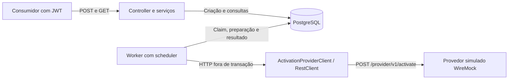

# AtivaFlow API

API REST em Java 21 e Spring Boot 3.5.16 para solicitar ativações de produtos e
consultar seu andamento. O pedido é persistido antes da resposta; um worker chama
o provedor em segundo plano. A API oferece autenticação JWT, isolamento por
consumidor, proteção contra duplicidade e consulta paginada.

## Arquitetura



O PostgreSQL armazena as solicitações e coordena os workers por posse temporária
(claim/lease) e versão. Cada etapa usa uma transação curta; a chamada externa
ocorre fora dela. O fluxo público é `PENDING → PROCESSING → COMPLETED` ou `FAILED`.
Quando o resultado externo é incerto, permanece `PROCESSING`, com reenvio bloqueado.

A base técnica inclui Spring Web/Validation, Spring Data JPA, Flyway, Spring
Security, Actuator/Micrometer e Springdoc. As decisões detalhadas estão nas
[ADRs](docs/adr/) e as fronteiras das camadas no
[guia de responsabilidades dos serviços](docs/service-responsibilities.md).

## Como executar

Execute na raiz de um clone limpo, em Bash, com **JDK 21, Docker Engine com Compose,
curl e jq**. Não é necessário instalar Maven: o projeto inclui o Wrapper.
As portas `8080` (API) e `8081` (WireMock) precisam estar livres.

### Início rápido

```bash
./scripts/dev-up.sh
./scripts/demo.sh
```

A inicialização prepara o `.env` quando ausente, reutiliza as chaves JWT locais e
aguarda os três serviços ficarem saudáveis. A demonstração cria uma solicitação
com JWT e consulta seu estado por até 60 segundos. `PROCESSING` após esse prazo
pode indicar espera por reconciliação e não representa falha do script.

<a id="provedor-simulado-no-compose"></a>

O Compose inicia API, PostgreSQL e WireMock. Consulte os endpoints em
[Swagger UI](http://localhost:8080/swagger-ui.html). Configuração, comandos manuais
e detalhes das credenciais estão na [referência de desenvolvimento local](docs/local-development.md).
Para executar os endpoints protegidos pela interface, siga o
[guia de autenticação JWT no Swagger](docs/swagger-jwt.md).

### Executar os testes

Com JDK 21 e Docker disponíveis, execute:

```bash
bash ./mvnw -B --no-transfer-progress verify
```

Os testes criam PostgreSQL com Testcontainers e servidores WireMock isolados;
não precisam do Compose nem do `.env`. Os tipos de teste e sua finalidade estão
na [seção Testes](#testes).

### Encerrar o ambiente

Use `./scripts/dev-down.sh` para encerrar os serviços preservando os dados do
PostgreSQL, o `.env` e as credenciais locais para a próxima execução.

## Decisões técnicas

<a id="criação-de-solicitações"></a>

**Processamento assíncrono persistido.** O POST confirma a criação em `PENDING`
após o commit, sem esperar o provedor. O scheduler busca trabalho durável no banco,
permitindo retomar pendências após reinício. Claim, lease e `@Version` coordenam
instâncias e impedem escritas de um worker que perdeu a posse. A preparação grava
a tentativa e ativa o bloqueio de reconciliação antes do HTTP, protegendo também
uma queda entre envio e gravação do resultado. Veja a
[ADR de processamento assíncrono](docs/adr/0003-processamento-assincrono.md).

<a id="idempotência-da-api-e-idempotência-da-operação-externa"></a>

**Duplicidade e concorrência.** Uma constraint `UNIQUE (external_id)` garante
unicidade global no PostgreSQL, inclusive entre réplicas; consulta prévia ou
`synchronized` não bastariam. Na disputa de inserção, a transação perdedora faz
rollback e a aplicação relê a vencedora. Mesmo consumidor e conteúdo retornam
`200`; conteúdo divergente ou outro consumidor recebe `409` genérico, sem expor
o registro alheio. A repetição não cria trabalho nem reinicia tentativas.
Isso garante idempotência local; o provedor não oferece idempotência contratada.
Detalhes na [ADR de duplicidade](docs/adr/0004-duplicidade-e-idempotencia.md).

**Persistência e integração.** Flyway versiona o schema e Hibernate apenas o
valida. O worker depende da porta `ActivationProviderClient`; o adaptador
`RestClient` traduz HTTP em resultados de domínio. WireMock permite reproduzir
sucesso, rejeição e lentidão sem outro serviço de negócio. Veja as ADRs de
[metadados](docs/adr/0001-metadados-de-processamento.md),
[contrato externo](docs/adr/0002-contrato-minimo-provedor.md) e
[simulação HTTP](docs/adr/0005-integracao-wiremock.md).

**Segurança implementada.** A API é um Resource Server stateless com JWT;
POST exige `requests/write` e GET exige `requests/read`. O `sub` validado identifica
o consumidor, aplicado às consultas e à criação; acesso por ID a recurso alheio
retorna `404`. Há validação de entrada, erros em Problem Details sem dados
internos, limite de corpo (16 KiB) e limite local de tráfego (120 requisições por
minuto por identidade, por padrão). O JWT do consumidor não é enviado ao provedor.
Emissor e gestão de segredos reais ainda precisam ser definidos, conforme o
[guia de segurança](docs/resource-server.md).

### Comportamento da integração

<a id="matriz-http--status--retry--justificativa"></a>

A tabela mostra o **status local após persistir o resultado do provedor**.
Esses retornos externos não mudam o HTTP do POST de criação, que já respondeu.

| Retorno do provedor | Novo status | Nova tentativa? | Justificativa |
| --- | --- | --- | --- |
| Sucesso: `200`, `201` ou `204` | `COMPLETED` | Não | São os únicos retornos contratados como ativação concluída. |
| Outros `2xx`, incluindo `202` | `PROCESSING`, com reconciliação | Não | Aceitação ou resposta não contratada não confirma conclusão. |
| HTTP `400` | `FAILED` | Não, em qualquer tentativa | O contrato assumido indica rejeição definitiva, sem ativação; ignora `Retry-After`. |
| HTTP `500` | `PROCESSING`, com reconciliação | Não | O erro pode ocorrer depois de ativar; `Retry-After` não prova ausência de efeito. |
| HTTP `429` / `503`, mesmo com `Retry-After`, no contrato padrão | `PROCESSING`, com reconciliação | Não | Status e prazo não garantem que o provedor deixou de ativar ou enfileirar. |
| HTTP `429` / `503` com contrato `rejected-before-activation` | `PROCESSING` enquanto aguarda; `FAILED` ao esgotar tentativas | Sim, dentro do limite e respeitando `Retry-After` válido e backoff | Exige garantia explícita de rejeição antes de qualquer ativação ou enfileiramento remoto. |
| Timeout de conexão/leitura ou falha de comunicação | `PROCESSING`, com reconciliação | Não | A ausência de resposta não confirma cancelamento da ativação. |
| Demais respostas (`3xx`, outros `4xx` e `5xx`) | `PROCESSING`, com reconciliação | Não | O efeito externo é desconhecido; redirecionamentos não são seguidos. |

Reconciliação significa manter `reconciliation_required=true` e impedir reenvio,
inclusive após restart, expiração do lease ou última tentativa. Ainda não há
rotina de reconciliação: é necessária evidência operacional do efeito externo.
As gravações exigem posse, versão e lease válidos; se não forem confirmadas,
a proteção preventiva permanece. Sucesso em `200/201/204` e rejeição em `400`
são suposições do projeto que precisam ser validadas com o provedor real.

**Resiliência.** Timeouts padrão: conexão `2s`, leitura `5s`. Retry seguro tem
até três tentativas totais (incluindo a inicial), configuráveis de uma a três,
com backoff exponencial de base `1s`, teto da base `1min` e jitter adicional de
até 25%. O banco persiste o maior prazo entre backoff e `Retry-After`, sem espera
bloqueante entre tentativas. Não há Circuit Breaker nesta etapa; sua adoção depende
de evidência de falhas e capacidade, conforme a
[ADR de resiliência](docs/adr/0006-resiliencia-sem-circuit-breaker.md).

<a id="habilitar-retry-http-no-contrato-seguro"></a>

Para demonstrar retry no mock, defina
`ACTIVATION_PROVIDER_RETRY_CONTRACT=rejected-before-activation` no `.env`, recrie
a API com `docker compose up -d app` e carregue o cenário opcional de `503` com
`Retry-After: 120`:

```bash
curl --fail-with-body --silent --show-error \
  --request POST http://localhost:8081/__admin/mappings \
  --header 'Content-Type: application/json' \
  --data-binary @infra/wiremock/scenarios/activation-rejected-before-activation.json
```

Um novo pedido termina em `FAILED` após três rejeições seguras. Para restaurar,
execute `curl --fail --request POST http://localhost:8081/__admin/mappings/reset`,
volte o contrato para `none` e recrie a API. Headers ausentes, malformados ou
passados preservam o backoff positivo; headers repetidos ou prazos fora do limite
suportado bloqueiam reenvio. As regras completas estão na
[ADR do contrato](docs/adr/0002-contrato-minimo-provedor.md).

## Testes

| Tipo e ferramentas | O que verificam e por quê |
| --- | --- |
| Unitários — JUnit 5, Mockito e AssertJ | Estados, validação, backoff, serviços e segurança isolados; dão retorno rápido sobre regras e casos de borda. |
| API e segurança — MockMvc/Spring Security Test | Contratos HTTP, `201/200/409`, filtros, escopos e isolamento por consumidor; evitam regressões públicas e acesso a recursos alheios. |
| Persistência — PostgreSQL com Testcontainers | Migrações, constraints, concorrência, claim/lease e commits reais; um banco em memória não reproduziria essas garantias do PostgreSQL. |
| Integração HTTP — WireMock | Payload, correlação, status, `Retry-After` e timeout no transporte real; mocks Java não exercitariam essa fronteira. |
| Fluxo assíncrono e restart — Spring Boot, PostgreSQL, WireMock e Awaitility | POST/commit → scheduler/worker → provedor → GET e retomada após reinício; verificam progresso e bloqueio de reenvio ambíguo. |
| Arquitetura — ArchUnit | Dependências entre camadas e isolamento do domínio/porta do provedor; preservam as fronteiras adotadas. |

Para uma verificação rápida de regras, sem Docker:

```bash
bash ./mvnw -B --no-transfer-progress \
  -Dtest=ActivationRequestTests,ActivationRetryPolicyTests,LayerArchitectureTests test
```

A suíte completa usa o `verify` mostrado em **Como executar**. O perfil `test`
desliga o scheduler por padrão; as suítes de processamento e restart o habilitam
explicitamente. A [CI](.github/workflows/ci.yaml) roda `verify` em Java 21 com Docker
e só constrói a imagem após os testes passarem.

## Cenário de análise

No cenário proposto, a latência da API passa de **300 ms para 2,5 s**, algumas
consultas de **50 ms para 1,2 s** e o provedor de **400 ms para 3 s**, com CPU em
**45%** e memória em **60%**. São dados do enunciado, não medições deste projeto.

1. **O que investigar primeiro?** Primeiro, verificaria quando a lentidão começou, quais operações foram afetadas e se houve alguma mudança recente na aplicação ou no volume de requisições. Em seguida, analisaria os tempos de resposta e possíveis pontos de espera, já que o uso de CPU e memória não indica, por si só, uma sobrecarga.
2. **Como separar aplicação, banco e provedor?** Analisaria separadamente o tempo gasto em cada etapa, desde o recebimento da requisição até as consultas ao banco e a comunicação com o provedor. Como a integração externa ocorre de forma assíncrona, sua lentidão não deveria afetar diretamente o tempo de resposta da criação da solicitação.
3. **Quais logs e métricas ajudam?** Utilizaria os logs com identificadores de correlação para acompanhar o processamento das solicitações. Também observaria os tempos de resposta da API, das consultas ao banco e do provedor, além da quantidade de erros, conexões disponíveis e solicitações aguardando processamento.
4. **Quais melhorias considerar?** As melhorias dependeriam da causa identificada. Poderia otimizar consultas e índices do banco, ajustar a quantidade de processamentos simultâneos ou revisar os limites de tempo da integração externa, sempre evitando alterações que comprometam a consistência das solicitações.
5. **Qual hipótese relaciona os sintomas?** Sim. Uma possibilidade seria a lentidão do provedor provocar acúmulo de solicitações, aumentando a carga sobre recursos compartilhados com a API e o banco. Para confirmar essa hipótese, compararia os horários em que os problemas começaram e realizaria testes simulando a lentidão do provedor.
6. **Como validar e reverter?** Compararia as métricas anteriores com os resultados após a correção, observando tempos de resposta, erros e quantidade de solicitações pendentes. Também acompanharia o comportamento da aplicação sob carga para garantir que a melhoria fosse consistente, mantendo a possibilidade de reverter a alteração caso surgissem novos problemas.

## Produção

**No contexto cloud e de microsserviços**, esta aplicação seria o serviço de
ativação: outros serviços autenticados enviariam pedidos e consultariam o status
por HTTP, sem acessar seu banco diretamente. Eu executaria a imagem em uma
plataforma de containers, atrás de ingresso HTTPS, com PostgreSQL gerenciado em
rede privada e um provedor real no lugar do WireMock. O deploy cloud ainda não
está implementado no repositório.

As réplicas poderiam receber tráfego sem afinidade de sessão e compartilhar o
banco exclusivo deste serviço. O protocolo de claim/lease coordena os workers
entre instâncias. Hoje API e worker rodam no mesmo processo; para escalar
separadamente, executaria réplicas HTTP com `WORKER_ENABLED=false` e réplicas
internas dedicadas ao processamento. Dimensionaria workers e conexões em conjunto,
pois cada worker processa sequencialmente e o provedor limita a vazão.
Se a evolução exigir mensageria, adotaria publicação transacional via outbox e
consumidores idempotentes, preservando o bloqueio de resultados desconhecidos.

A execução usaria `SPRING_PROFILES_ACTIVE=prod`, `DB_URL`, `DB_USERNAME`,
`DB_PASSWORD`, `ACTIVATION_PROVIDER_BASE_URL` e configuração JWT do emissor real,
com segredos injetados por cofre. Validaria autenticação e contrato do provedor
antes da troca; `ACTIVATION_PROVIDER_API_KEY` ainda é apenas reserva de
configuração, sem header enviado. O Dockerfile já usa build em estágios e usuário
sem privilégios. Planejaria migrações Flyway compatíveis, backup/restauração,
limites de recursos, shutdown gracioso e rollout com rollback.

<a id="probes-de-saúde"></a>

**Saúde.** Usaria `/actuator/health/liveness` para o estado interno e
`/actuator/health/readiness` para aceitar tráfego somente com banco disponível.
O provedor não participa da readiness, pois o processamento é assíncrono.
As probes são públicas e ocultam detalhes internos.

<a id="acesso-ao-prometheus"></a>

**Monitoramento.** Logs JSON já estão ativos no perfil `prod`, com correlação
persistida até o provedor. `/actuator/prometheus` exige JWT com `monitoring/read`;
o coletor precisa de identidade própria, renovação do token e acesso por rede
interna. A API não emite tokens nem renova a credencial do coletor. Localmente:

```bash
java scripts/LocalJwt.java monitor-token "$JWT_DEMO_DIR"
curl --fail --silent --show-error http://localhost:8080/actuator/prometheus \
  --header "@$JWT_DEMO_DIR/monitoring.header"
```

Na coleta contínua, a credencial deve ser renovada antes de expirar. O token local
vale cinco minutos. As métricas incluem HTTP/JVM/Hikari, tentativas,
timeouts/retries e snapshot periódico de totais por estado. Em múltiplas réplicas,
os totais globais do banco são repetidos por instância e não devem ser somados.
Definiria alertas de erros, latência e reconciliação; acrescentaria idade da fila
e tracing para acompanhar o fluxo entre serviços.

## Pontos pendentes

| O que falta | Como faria |
| --- | --- |
| Contrato real, autenticação e idempotência do provedor | Validar garantias, adaptar o cliente e testar o contrato antes de permitir reenvios adicionais. |
| Reconciliação de resultados incertos | Criar consulta/callback ou procedimento auditável que obtenha evidência do provedor antes de concluir ou liberar nova tentativa. |
| Emissor JWT, cofre e infraestrutura cloud | Provisionar identidade M2M, rotação de segredos, rede privada e entrega automatizada, conforme o [guia de segurança](docs/resource-server.md). |
| Tracing e métricas de idade da fila/ocupação | Instrumentar entrada, banco e worker e definir painéis/SLOs. |
| Renovação de lease durante chamadas longas | Implementar heartbeat condicionado à posse, se a operação exigir; hoje o lease precisa comportar HTTP e gravação. |

## Melhorias futuras

- Medir carga real e planos SQL antes de adicionar índices específicos de claim,
  aumentar concorrência ou ajustar pools.
- Centralizar a política de rate limit no ingresso para múltiplas réplicas;
  o limitador atual mantém contadores em memória por instância.
- Adotar controle de admissão/backpressure e avaliar Circuit Breaker conforme
  falhas, vazão e backlog observados.
- Evoluir a CI para publicar imagens em registry e fazer deploy gradual;
  hoje ela executa `verify` e build Docker, sem publicar nem implantar.

## Uso de Inteligência Artificial

O desenvolvimento do AtivaFlow contou com o apoio do OpenAI Codex ao longo de todo o ciclo de desenvolvimento de software.

Inicialmente, utilizei a IA para extrair e organizar os requisitos do desafio a partir do arquivo HTML fornecido. Com base nessa análise, elaborei especificações técnicas próprias, defini um planejamento de implementação por etapas e adotei uma abordagem de desenvolvimento orientada por especificações (Spec-Driven Development).

Durante a implementação, utilizei o Codex como assistente de programação, apoiado por Skills especializadas em Java, Spring Boot, Spring Security, TDD, boas práticas de desenvolvimento, depuração sistemática (Systematic Debugging) e verificação antes da conclusão (Verification Before Completion). A ferramenta também auxiliou na criação de testes automatizados, refatorações e documentação.

O processo foi colaborativo, incluindo sessões de brainstorming e discussões sobre alternativas de implementação, nas quais avaliei diferentes abordagens antes de definir as soluções. Também realizei revisões do código gerado, verificando regras de negócio, organização, legibilidade, segurança e resultados dos testes.

Dessa forma, a IA foi utilizada para aumentar a produtividade e apoiar decisões técnicas, mantendo minha participação ativa no planejamento, na revisão das implementações e na validação da qualidade da solução.
