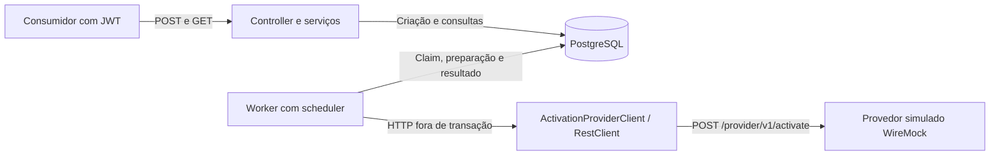

# AtivaFlow API

API REST Java 21 com Spring Boot 3.5.16 para receber solicitações de ativação de
produtos, persistir o trabalho e consultar seu andamento. O POST confirma a
criação sem aguardar o provedor; um worker com scheduler habilitado por padrão
busca trabalho no PostgreSQL e chama o provedor via HTTP após o commit.
A API oferece consulta individual e listagem paginada, autenticação JWT,
escopos de leitura/escrita e isolamento por consumidor. Repetições idênticas
reutilizam a solicitação; divergências retornam conflito.

## Arquitetura e estado atual



O banco mantém o trabalho durável e coordena instâncias por claim, lease e versão.
Cada etapa de escrita do worker confirma sua própria transação curta antes da
seguinte. O estado público segue `PENDING → PROCESSING → COMPLETED` ou `FAILED`;
um resultado externo indeterminado permanece em `PROCESSING` e bloqueia reenvio.

| Situação | Implementação, evidência ou limite |
| --- | --- |
| Implementado | API, validação e Problem Details; JWT/escopos/BOLA; unicidade global e repetição 201/200/409; worker, HTTP e persistência de resultados; Dockerfile e Compose. |
| Cobertura automatizada existente | Testes de endpoints e concorrência com PostgreSQL/Testcontainers, autorização, cliente HTTP com WireMock, orquestração e recuperação. O perfil `test` desliga o scheduler; as evidências específicas estão em [Testes e integração contínua](#testes-e-integração-contínua). |
| Demonstração documentada | [Roteiro completo](docs/container-image.md#demonstração-autenticada-e-retomada-de-pendências) de JWT, POST/GET, chamada ao mock e retomada de `PENDING` após recriação com volume persistente. A execução registrada em [A01](PENDING_ACTIONS.md#a01--empacotamento-e-execução-reproduzível) não substitui testes automatizados com scheduler ativo. |
| Limitações da integração | Sem idempotência garantida pelo provedor, reconciliação automática ou renovação de lease. `429/503` e timeouts são indeterminados; o cliente não habilita retry HTTP nem interpreta `Retry-After`. |
| Próximas evoluções | Completar testes integrados de sucesso/500/timeout e retomada pelo scheduler; limites de body/tráfego; probes explícitas, Prometheus, métricas de negócio, logs JSON e tracing opcional. Detalhes e prioridades em [Ações pendentes](PENDING_ACTIONS.md). |

## Roteiro curto de uso

Execute na raiz do projeto em Bash com JDK 21, Docker Engine/Compose, curl e jq.
As portas `8080` e `8081` devem estar livres. Os comandos usam o Compose completo;
para PostgreSQL próprio e API na máquina, veja [Execução local](#execução-local).

1. Copie `.env.example` para `.env` se ainda não existir e preencha `DB_PASSWORD`.
   Mantenha `SERVER_PORT=8080` neste roteiro. O Compose lê `.env` automaticamente.
2. Gere o JWT efêmero e disponibilize somente a chave pública ao container:

   ```bash
   export JWT_DEMO_DIR="$(java scripts/LocalJwt.java create)"
   source "$JWT_DEMO_DIR/env.sh"
   export JWT_PUBLIC_KEY_FILE="$PWD/.env.jwt-public.pem"
   cp -- "$JWT_DEMO_DIR/public.pem" "$JWT_PUBLIC_KEY_FILE"
   chmod 0444 "$JWT_PUBLIC_KEY_FILE"
   docker compose config --quiet
   docker compose up --build -d --wait
   curl --fail http://localhost:8080/actuator/health
   ```

3. Após o build, renove o token de cinco minutos e envie a solicitação. O header
   Bearer é lido do arquivo privado, sem copiar o token para o comando:

   ```bash
   java scripts/LocalJwt.java token "$JWT_DEMO_DIR"
   export DEMO_EXTERNAL_ID="QUICKSTART-$(date -u +%Y%m%dT%H%M%SZ)-$RANDOM"
   export DEMO_PAYLOAD="$(jq -nc --arg id "$DEMO_EXTERNAL_ID" \
     '{externalId:$id,customerId:"CUST-001",productCode:"INTERNET-500"}')"
   curl --fail-with-body --silent --show-error --dump-header "$JWT_DEMO_DIR/post.headers" \
     --header "@$JWT_DEMO_DIR/authorization.header" \
     --header 'Content-Type: application/json' --data "$DEMO_PAYLOAD" \
     http://localhost:8080/api/v1/requests > "$JWT_DEMO_DIR/created.json"
   cat "$JWT_DEMO_DIR/post.headers"
   jq . "$JWT_DEMO_DIR/created.json"
   export DEMO_REQUEST_ID="$(jq -er '.id' "$JWT_DEMO_DIR/created.json")"
   ```

   A criação retorna `201`, `Location` e a fotografia em `PENDING`. O token local
   inclui `requests/write` para POST e `requests/read` para GET.
4. Consulte o registro com o mesmo consumidor. Repita o GET até observar
   `COMPLETED` com o mapping padrão `204` do mock; a primeira consulta pode
   retornar `PENDING` ou `PROCESSING`:

   ```bash
   curl --fail-with-body --silent --show-error \
     --header "@$JWT_DEMO_DIR/authorization.header" \
     "http://localhost:8080/api/v1/requests/$DEMO_REQUEST_ID" | jq .
   ```

   Reenviar o mesmo payload com o mesmo token retorna `200` e o estado atual.
   Alterar cliente/produto mantendo `externalId` retorna `409`. Sem token, `401`;
   com token válido sem escopo, `403`; entrada inválida, `400`. Veja os exemplos
   de [criação](#criação-de-solicitações), [erros](#tratamento-centralizado-de-erros)
   e [renovação JWT](docs/local-jwt.md#verificar-a-api-e-renovar-o-token).
5. Encerre os serviços e remova os arquivos gerados neste roteiro:

   ```bash
   docker compose down
   rm -- "$JWT_PUBLIC_KEY_FILE"
   rm -r -- "$JWT_DEMO_DIR"
   unset JWT_DEMO_DIR JWT_PUBLIC_KEY_FILE DEMO_EXTERNAL_ID DEMO_PAYLOAD DEMO_REQUEST_ID
   ```

O volume do PostgreSQL permanece após `down`; mantenha a senha para reutilizá-lo.
Para subir novamente, gere o material JWT e copie a nova chave pública antes de
`up`. O [guia completo](docs/container-image.md#ambiente-completo-com-docker-compose)
explica portas, configuração e confirmação no WireMock, shutdown/restart e
retomada de pendências. O mock usa o contrato assumido na
[ADR-0002](docs/adr/0002-contrato-minimo-provedor.md); um provedor real exige
validação desse contrato, autenticação própria e estratégia de reconciliação.

## Tecnologias e dependências

As dependências e os plugins de build estão definidos no `pom.xml`:

| Área | Componentes |
| --- | --- |
| API HTTP | Spring Web e Bean Validation |
| Documentação da API | Springdoc OpenAPI e Swagger UI |
| Persistência | Spring Data JPA, PostgreSQL e Flyway |
| Segurança | Spring Security e OAuth2 Resource Server |
| Monitoramento | Spring Boot Actuator e Micrometer com registro Prometheus |
| Mapeamento e geração de código | MapStruct e Lombok |
| Desenvolvimento | Spring Boot DevTools e Maven Wrapper |
| Testes | Spring Boot Test, Spring Security Test, Testcontainers, WireMock, ArchUnit e Awaitility |

A presença dessas dependências não implica que todas as funcionalidades estejam
implementadas ou expostas pela aplicação.

## Pacotes

Pacote base: `com.rensilver.ativaflow_api`.

| Pacote | Responsabilidade definida |
| --- | --- |
| `config` | Configurações Spring e propriedades da aplicação. |
| `controller` | Endpoints REST, validação de entrada e respostas HTTP. |
| `service` | Orquestração dos casos de uso e delimitação de transações. |
| `service.model` | Resultados e fotografias imutáveis do processamento dos serviços. |
| `service.policy` | Políticas de execução, como cálculo de backoff e jitter. |
| `repository` | Acesso a dados com Spring Data JPA e operações de persistência. |
| `domain` | Regras, estados e resultados de negócio. |
| `domain.exception` | Exceções de regras e transições de domínio. |
| `model` | Entidades JPA e mapeamentos de persistência. |
| `dto.request` | Contratos de entrada da API. |
| `dto.response` | Contratos de saída da API. |
| `mapper` | Conversões entre entidades e DTOs com MapStruct. |
| `client.provider` | Contrato e implementação HTTP da integração com o provedor. |
| `client.provider.dto` | Contratos exclusivos da integração com o provedor. |
| `exception` | Tratamento HTTP centralizado de erros. |
| `security` | Autenticação, autorização e identidade do consumidor. |
| `worker` | Agendamento e processamento de trabalho persistido. |
| `observability` | Correlação, métricas e suporte a tracing. |

`AtivaflowApiApplication.java` contém o ponto de entrada da aplicação.

A análise de responsabilidades, dependências e fronteiras transacionais da camada
de serviços está em [Responsabilidades dos serviços](docs/service-responsibilities.md).

## Arquivos de configuração

| Arquivo | Finalidade |
| --- | --- |
| `pom.xml` | Dependências, versão do Java, plugins e processadores de anotações. |
| `mvnw` e `mvnw.cmd` | Execução do Maven Wrapper em Unix e Windows. |
| `.mvn/wrapper/maven-wrapper.properties` | Versão e distribuição do Maven utilizadas pelo Wrapper. |
| `src/main/resources/application.yaml` | Configuração compartilhada: porta, Flyway, JPA, pool de conexões, timeouts HTTP e desligamento gracioso. |
| `src/main/resources/application-local.yaml` | Conexão com PostgreSQL e URL do provedor no ambiente local. |
| `src/main/resources/application-prod.yaml` | Configuração por variáveis de ambiente e desativação do DevTools em produção. |
| `src/test/resources/application-test.yaml` | Configuração do provedor para o perfil de testes. |
| `.env.example` | Modelo de variáveis para execução local. |
| `docker-compose.yaml` | API, PostgreSQL com volume persistente e provedor simulado WireMock. |
| `infra/wiremock/mappings/activation-success.json` | Mapping estático de sucesso: `POST /provider/v1/activate` retorna `204`, sem corpo. |
| `.github/workflows/ci.yaml` | Build e testes no GitHub Actions. |
| `.gitignore` | Exclusões de build, arquivos de IDE e configurações locais de ambiente. |
| `.gitattributes` | Padronização de finais de linha dos scripts do Maven Wrapper. |

O Hibernate está configurado com `ddl-auto: validate` e `open-in-view: false`.
O Flyway está habilitado explicitamente na configuração compartilhada e aplica
as migrações de `classpath:db/migration` na inicialização, antes da validação do
Hibernate. Com `validate-on-migrate: true`, divergências no histórico de migrações,
como checksums alterados, impedem a inicialização. O Hibernate apenas valida os
mapeamentos JPA contra o schema; alterações de estrutura devem ser feitas por
novas migrações. Com `open-in-view: false`, o contexto de persistência não permanece
aberto durante toda a requisição HTTP; o carregamento de associações lazy deve
ocorrer dentro da transação da aplicação.

O `baseline-on-migrate: false` impede a criação automática de um baseline em um
schema não vazio sem histórico Flyway. Bancos existentes nessa condição precisam
de uma estratégia explícita de adoção antes de iniciar a aplicação.

A migração `V1__create_activation_requests.sql` cria a tabela `activation_requests`:

| Coluna | Tipo e regras |
| --- | --- |
| `id` | UUID, chave primária; gerado pela aplicação. |
| `external_id` | `VARCHAR(100)`, obrigatório e único globalmente. |
| `customer_id` | `VARCHAR(100)`, obrigatório; identificador textual do cliente. |
| `product_code` | `VARCHAR(100)`, obrigatório. |
| `status` | `VARCHAR(20)`, obrigatório; aceita `PENDING` (padrão), `PROCESSING`, `COMPLETED` e `FAILED`. |
| `created_at` | `TIMESTAMP WITH TIME ZONE`, obrigatório; padrão `CURRENT_TIMESTAMP`. |
| `updated_at` | `TIMESTAMP WITH TIME ZONE`, obrigatório; padrão `CURRENT_TIMESTAMP`. |

A V1 cria a constraint `uk_activation_requests_external_id UNIQUE (external_id)`.
A chave contém apenas `external_id`: o mesmo valor colide mesmo quando consumidor,
cliente, produto ou status diferem. Essa regra é aplicada pelo PostgreSQL a todas
as escritas na tabela.

Os nomes em `snake_case` correspondem aos campos `externalId`, `customerId`,
`productCode`, `createdAt` e `updatedAt` do contrato da API. O limite adotado para
os três identificadores textuais é de 100 caracteres. As datas representam
instantes, compatíveis com `Instant` e exposição em UTC. O padrão de `updated_at`
vale apenas para inserções; a aplicação o atualiza por auditoria JPA ou
explicitamente nas operações SQL do worker, sem trigger no banco. A entidade
aplica as transições de status descritas abaixo.

A migração `V2__add_activation_request_owner_and_processing_metadata.sql`
adiciona os campos internos abaixo, preservando a V1 e o contrato público:

| Coluna interna | Tipo e finalidade |
| --- | --- |
| `consumer_id` | `VARCHAR(100)`, obrigatório, sem padrão; rejeita texto vazio ou composto apenas por espaços em branco. Identifica o consumidor proprietário da solicitação. |
| `version` | `BIGINT`, obrigatório, padrão `0`, não negativo; controle de concorrência otimista com `@Version`. |
| `attempt_count` | `INTEGER`, obrigatório, padrão `0`, não negativo; quantidade de tentativas de envio ao provedor. |
| `next_attempt_at` | `TIMESTAMP WITH TIME ZONE`, opcional; instante da próxima tentativa, quando houver retry agendado. |
| `lease_until` | `TIMESTAMP WITH TIME ZONE`, opcional; vencimento da posse temporária do processamento. |
| `claimed_by` | `VARCHAR(100)`, opcional; identificador da instância/worker que assumiu o trabalho. |
| `last_error_code` | `VARCHAR(100)`, opcional; código categorizado da última falha, sem payload, credenciais ou resposta bruta do provedor. |
| `reconciliation_required` | `BOOLEAN`, obrigatório, padrão `false`; indica resultado externo indeterminado que exige reconciliação. |

A migração `V4__add_activation_request_correlation_id.sql` acrescenta
`correlation_id VARCHAR(128)`, opcional e imutável na entidade. Ela preserva a
correlação da criação até o worker, sem alterar os campos JSON públicos. Registros
anteriores continuam válidos com esse campo nulo.

O contrato de uso desses campos está definido na
[ADR-0001 — Metadados de processamento](docs/adr/0001-metadados-de-processamento.md),
incluindo contagem antes do envio, próximo agendamento, validade do lease,
proteção por versão e recuperação de resultado indeterminado. A preparação
atômica ativa `reconciliation_required` preventivamente antes do HTTP; a gravação
de resultado confirmado remove essa proteção na mesma atualização que conclui,
encerra em falha ou agenda um retry seguro. Assim, uma queda entre envio e gravação
do resultado não libera um reenvio automático. Claim, preparação, persistência de
resultados e liberação de leases vencidos estão implementados conforme as seções
abaixo. O worker integra essas operações ao cliente HTTP já implementado.

`consumer_id` é diferente de `customer_id`: o primeiro identifica o sistema
consumidor autenticado; o segundo identifica o cliente informado no pedido.
A derivação de `consumer_id` usa `Principal.getName()`, definido explicitamente
por `ConsumerJwtAuthenticationConverter` a partir do `sub` original do JWT validado.
Esse claim deve ser uma string não branca de até 100 unidades UTF-16, sem
normalização, truncamento ou fallback para `client_id`/outros claims. Identidade
ausente ou inválida resulta em `401` antes de acessar o banco. O proprietário não
pode ser aceito do body. Os DTOs públicos aceitam apenas `externalId`,
`customerId` e `productCode` na criação e expõem apenas `id`, `externalId`,
`customerId`, `productCode`, `status`, `createdAt` e `updatedAt` nas respostas.
Nenhuma das colunas internas, incluindo `correlation_id`, é exposta no JSON público.

O schema, a entidade JPA e os DTOs estão implementados e cobertos por testes.
Scheduler e chamada HTTP estão implementados; reconciliação automática permanece
pendente. O claim atribui leases e retoma somente trabalho comprovadamente seguro;
a preparação registra a tentativa antes do HTTP. A recuperação explícita de leases
está disponível como serviço interno, sem agendamento próprio.
Os campos opcionais começam nulos; a sinalização de reconciliação
mantém um resultado ambíguo em
`PROCESSING`, sem adicionar estados públicos. Claim, preparação e gravação de
resultado aplicam o limite configurado de até três tentativas totais; a constraint do banco impede somente contagens
negativas. A unicidade de `external_id` continua global, inclusive entre
consumidores. Os índices de listagem estão na V3; índices específicos para claim
ainda não foram adicionados e dependerão da avaliação do plano e do volume de trabalho.

`model.ActivationRequest` mapeia as colunas de V1/V2 e a correlação da V4, com acesso JPA pelos
campos e construtor sem argumentos `protected`, compatível com o Hibernate.
O código de aplicação usa `ActivationRequest.create(externalId, customerId,
productCode, trustedConsumerId)`. A factory delega a um construtor privado,
exige texto não vazio de até 100 caracteres e preserva os valores sem normalização.
Ela gera o UUID na aplicação e inicia em `PENDING`. O proprietário
deve ser fornecido pela camada de autenticação confiável, nunca pelo payload.
Não há construtor público para criação automática pelo MapStruct. A factory
não recebe UUID, status, versão ou datas de auditoria.

A entidade expõe getters, sem setters públicos ou builder. As mudanças de estado
ocorrem por `startProcessing()` (`PENDING → PROCESSING`), `complete()`
(`PROCESSING → COMPLETED`) e `fail(errorCode)` (`PROCESSING → FAILED`).
Transições inválidas lançam `InvalidActivationStatusTransitionException`;
estados terminais não podem ser reabertos. `fail` exige texto não vazio de até
100 caracteres para `last_error_code`; o chamador deve fornecer apenas um código
categorizado, sem resposta bruta do provedor. Retry é registrado pelo serviço de
resultados; reconciliação continua pendente. O claim usa SQL condicional no repositório, conforme
descrito abaixo. O protocolo de envio é implementado pelo worker e pelos serviços,
sem delegar a coordenação à entidade.

`createdAt` e `updatedAt` usam `Instant`, com `@CreatedDate`, `@LastModifiedDate`
e `AuditingEntityListener`. `JpaAuditingConfiguration` habilita a auditoria com
um `DateTimeProvider` baseado em `Clock.systemUTC()`. As datas são preenchidas
na persistência; `updatedAt` também muda quando uma alteração é enviada ao banco,
e `createdAt` não é atualizável. Identidade e campos de criação também não são
atualizáveis. Todos os horários internos usam `Instant`, compatível com as colunas
`TIMESTAMP WITH TIME ZONE`, sem depender do fuso local da JVM ou da sessão SQL.

O campo `version` é `Long` com `@Version`: permanece nulo antes da primeira
persistência (permitindo ao Spring Data reconhecer uma entidade nova mesmo com
UUID atribuído), recebe `0` na inserção e é incrementado pelo Hibernate nas
atualizações. Gravações com versão desatualizada são rejeitadas por lock otimista.
Atualizações SQL diretas, como o claim do worker, controlam explicitamente a
versão e a auditoria, pois não passam pelos callbacks JPA.

A V2 pressupõe a tabela `activation_requests` vazia, conforme o cenário atual
de desenvolvimento. Não há proprietário padrão nem backfill inferido de
`customer_id` ou `external_id`. Se a V1 tiver registros, a adição de
`consumer_id NOT NULL` falhará: será necessário planejar a atribuição dos
proprietários antes de aplicar essa migração a um banco com dados.

O diretório `infra/wiremock/mappings/` contém o mapping padrão de sucesso do
provedor simulado. `infra/wiremock/__files/` está reservado para arquivos de
resposta, caso necessários. As decisões técnicas estão em `docs/adr/`.

## Aquisição atômica pelo worker

`service.ActivationRequestClaimService.claimNext(workerId)` adquire no máximo
uma solicitação e retorna `Optional<ClaimedActivationRequest>`, com `id`, versão
resultante, `claimedBy` e `leaseUntil`. O identificador do worker deve conter texto
não vazio de até 100 unidades UTF-16. A duração é configurada por
`app.worker.lease-duration` / `WORKER_LEASE_DURATION`, com padrão `30s` e mínimo
de um milissegundo; a duração efetiva usa milissegundos inteiros.

A chamada ao bean Spring abre uma transação própria (`REQUIRES_NEW`), seleciona
uma candidata por `created_at ASC, id ASC` com `FOR UPDATE SKIP LOCKED` e executa
um `UPDATE` condicionado por ID, versão e elegibilidade. Linhas bloqueadas por
outras transações são ignoradas. A operação exige exatamente uma linha afetada:
zero produz resultado vazio; contagem inesperada lança exceção e reverte a
transação. Sem candidata, também retorna vazio.

A seleção e a atualização exigem ausência de lease válido, menos de três
tentativas e `reconciliation_required=false`, além de uma destas condições:

- `PENDING`, contador zero e sem agendamento;
- `PROCESSING` com retry agendado já vencido;
- `PROCESSING`, contador zero e sem agendamento, representando claim inicial
  abandonado antes da preparação do envio.

O PostgreSQL fornece `CURRENT_TIMESTAMP` para comparar agendamento e lease e
atribuir `lease_until` e `updated_at`. Lease vencido inclui igualdade ao instante
atual. A aquisição muda o status para `PROCESSING`, preenche os dois campos de
posse e incrementa `version`. Preserva contador, agendamento de retry, último
erro, sinalização de reconciliação e dados de criação. O contexto JPA é limpo
após o SQL direto, e a releitura retorna os metadados efetivamente persistidos.
O proxy Spring confirma o commit antes de entregar o resultado ao chamador,
inclusive quando uma transação externa depois sofre rollback.

O incremento explícito da versão no claim invalida entidades carregadas antes
dele: tanto o flush de uma entidade gerenciada quanto o merge de uma entidade
desatualizada são rejeitados pelo controle otimista, preservando a linha vencedora.
Isso também vale quando um lease vencido é retomado pelo mesmo `workerId`:
a versão identifica a nova posse. Uma versão antiga não volta a ser válida
quando o lease expira novamente. Conflitos não devem ser contornados relendo a
versão atual para repetir uma gravação com dados antigos.

Os testes de integração com PostgreSQL verificam essa interação entre JPA e
SQL nativo, o descarte da candidata no contexto JPA e a preservação de estados
terminais quando conclusão e falha disputam a mesma versão.

O claim sozinho não autoriza HTTP: a preparação descrita abaixo aplica as
verificações de posse, versão e lease da ADR-0001. As escritas de resultado
também aplicam essas verificações. Resultados indeterminados,
tentativas esgotadas, retries futuros e estados terminais não são adquiridos.
Não há nova migração nesta etapa.

Referências: [locks e SKIP LOCKED no PostgreSQL](https://www.postgresql.org/docs/17/sql-select.html#SQL-FOR-UPDATE-SHARE)
e [atualizações diretas no Spring Data JPA](https://docs.spring.io/spring-data/jpa/reference/jpa/query-methods.html#jpa.modifying-queries).

## Preparação da tentativa e recuperação de leases

`ActivationRequestAttemptService.prepareAttempt(claim)` recebe a fotografia
retornada pelo claim e executa uma atualização condicional em transação própria
(`REQUIRES_NEW`). Exige ID, versão e worker correspondentes, status `PROCESSING`,
lease válido (`lease_until > CURRENT_TIMESTAMP`), menos de três tentativas,
ausência de reconciliação e primeiro envio ou retry seguro já vencido.

Na mesma atualização, incrementa `attempt_count`, remove `next_attempt_at`,
ativa `reconciliation_required`, incrementa `version` e atualiza `updated_at`.
Preserva o lease, os dados da solicitação e o último erro. Somente após o commit
o chamador recebe `Optional<PreparedActivationAttempt>`, contendo ID, nova
versão, worker, vencimento e número da tentativa. Essa versão deve ser usada na
persistência do resultado; a versão do claim anterior ficou obsoleta.
Resultado vazio ou falha no commit impede iniciar HTTP. A mesma preparação não
pode ser usada para autorizar outro envio, inclusive em chamadas concorrentes.
`ActivationRequestWorker` chama o provedor somente depois que claim e preparação
confirmam seus commits, fora de transação de banco, e respeita o vencimento da
posse; a preparação não renova o lease.

`ActivationRequestLeaseRecoveryService.recoverExpiredLeases(batchSize)` libera
até `batchSize` claims vencidos de solicitações `PROCESSING` e retorna a quantidade
liberada. O lote deve ser positivo. A operação usa uma transação própria curta e
um único SQL com seleção por `lease_until ASC, id ASC`, `FOR UPDATE SKIP LOCKED`
e atualização condicionada por ID, versão, status e vencimento. Leases válidos,
linhas sem lease e estados diferentes de `PROCESSING` ficam intactos.

O recuperador remove `claimed_by` e `lease_until` juntos, incrementa `version`
e atualiza `updated_at`. Preserva status, tentativas, próximo agendamento, último
erro e sinalização de reconciliação. Zero significa que nenhum claim foi liberado;
não significa que não existam linhas bloqueadas por outra transação. A operação
pode ser repetida e executada por múltiplas instâncias sem liberar duas vezes a
mesma posse. O claim também pode retomar diretamente trabalho seguro vencido,
sem depender de uma execução prévia do recuperador.

| Situação quando o lease vence | Após liberar a posse | Novo envio automático? |
| --- | --- | --- |
| Claim inicial abandonado antes da preparação | Contador `0`, sem agendamento, reconciliação `false`. | Pode adquirir novo claim e preparar a primeira tentativa. |
| Claim de retry seguro abandonado antes da preparação | Contador e agendamento seguro preservados. | Somente quando o agendamento vencer e houver tentativas disponíveis. |
| Queda depois do commit da preparação, inclusive antes da conexão HTTP | Contador incrementado, sem agendamento, reconciliação `true`. | Bloqueado até evidência externa confiável. |
| Timeout ou resposta externa desconhecida | Continua `PROCESSING` com reconciliação `true`, inclusive na terceira tentativa. | Bloqueado; expiração não comprova ausência de ativação. |
| Contador positivo sem agendamento e sem sinalização | Metadados preservados, sem evidência de retry seguro. | Bloqueado; exige avaliação operacional. |

O relógio do PostgreSQL decide a validade: no instante exato de `lease_until`,
a posse já venceu e não pode preparar uma tentativa. Uma recuperação ou novo
claim invalida o worker anterior pela versão, mesmo se o identificador do worker
for reutilizado. A liberação nunca converte uma expiração em `FAILED`, zera o
contador ou remove a proteção de reconciliação.

Sem consulta externa ou idempotência garantida pelo provedor, as tentativas
indeterminadas exigem intervenção operacional; não há reconciliação automática
ou endpoint para liberar reenvios. No shutdown, deve-se deixar expirar a posse
de uma tentativa autorizada sem apagar sua sinalização preventiva. Nenhuma dessas
operações promete efeito externo exatamente uma vez.

O `ActivationRequestWorker` usa claim, preparação e `ActivationRequestOutcomeHandler`
para coordenar o envio e a gravação. Seu `poll()` usa `@Scheduled`, com intervalo
configurável, e drena o trabalho elegível; `poll()` e `processNext()` usam
`NOT_SUPPORTED` para suspender uma eventual transação chamadora.
Não há renovação automática de lease: se ele vencer durante o HTTP, a gravação
tardia é recusada e a proteção preventiva mantém o bloqueio.
Os métodos básicos da entidade (`complete()` e `fail()`) não implementam o
protocolo de resultado; o worker usa os serviços de atualização condicional.
Os metadados continuam ausentes dos DTOs públicos, sem alteração dos quatro status.

## Resultados confirmados e agendamento de retries

`ActivationRequestOutcomeService` recebe `PreparedActivationAttempt` e persiste
o resultado em uma transação curta `REQUIRES_NEW`. Cada operação exige ID,
versão, worker, status `PROCESSING`, lease válido, proteção de reconciliação ativa
e o mesmo contador da tentativa preparada. Não incrementa novamente o contador.
Na mesma atualização, libera os dois campos da posse, remove a proteção preventiva,
incrementa `version` e atualiza `updated_at`.

| Operação interna | Resultado persistido |
| --- | --- |
| `recordSuccess(attempt)` | `COMPLETED`, sem agendamento ou último erro. |
| `recordPermanentFailure(attempt, errorCode)` | `FAILED`, sem agendamento, com código categorizado. |
| `recordSafeTransientFailure(attempt, errorCode, retryAfter)` | Antes do limite configurado, `PROCESSING` com próximo instante futuro e erro; ao atingir o limite, `FAILED` sem agendamento. |

As operações retornam `true` após o commit; `false` significa que nenhuma linha
foi alterada, por exemplo por perda de posse ou resultado já registrado. Contagem
inesperada lança exceção e reverte a transação. Resposta tardia após recuperação
do lease não pode remover a proteção de reconciliação. A gravação de resultado
indeterminado continua em `ActivationRequestAttemptService.recordAmbiguousOutcome`.

`ActivationRetryPolicy` calcula a base `min(initialDelay * 2^(attemptCount - 1), maxDelay)`
e adiciona jitter aleatório entre zero e `base * jitterRatio` (limite superior exclusivo,
com truncamento para milissegundos). Por padrão, a primeira falha segura agenda
em 1–1,25 s; a segunda, em 2–2,5 s. A terceira falha confirmada encerra em `FAILED`.
O limite de 1 min vale para a base, antes do jitter; com os padrões e apenas
três tentativas, esse teto não chega a ser atingido.

| Variável | Padrão | Validação |
| --- | --- | --- |
| `WORKER_ENABLED` | `true` | Liga ou desliga o worker de polling. |
| `WORKER_POLL_INTERVAL` | `250ms` | Intervalo entre varreduras do trabalho persistido. |
| `WORKER_LEASE_DURATION` | `30s` | Posse temporária usada pelo claim; deve ser maior que zero. |
| `WORKER_RETRY_MAX_ATTEMPTS` | `3` | Inteiro de 1 a 3; inclui a primeira tentativa. `1` desabilita reenvios. |
| `WORKER_RETRY_INITIAL_DELAY` | `1s` | Pelo menos 1 ms. |
| `WORKER_RETRY_MAX_DELAY` | `1m` | Maior ou igual ao atraso inicial. |
| `WORKER_RETRY_JITTER_RATIO` | `0.25` | Número finito entre 0 e 1; zero desabilita jitter. |

`ActivationRetryProperties` usa `@ConfigurationProperties("app.worker.retry")`
e `@Validated`. Valores inválidos, atraso máximo menor que o inicial e overflow
na representação em milissegundos ou na soma com jitter impedem a inicialização.
O mesmo limite é aplicado à seleção de candidatos, ao claim condicional, à
preparação de tentativas e ao registro de falhas seguras. Resultados ambíguos
continuam bloqueados para reconciliação, inclusive na última tentativa configurada.

O PostgreSQL persiste `next_attempt_at = max(CURRENT_TIMESTAMP + atraso, retryAfter)`.
`retryAfter` é um `Instant` opcional fornecido pelo chamador do serviço;
ausência ou data passada preserva o backoff positivo. Uma data futura posterior
ao backoff é respeitada inclusive além do teto da base. O SQL também rejeita
atrasos de retry menores que 1 ms. A data escolhida fica persistida: polling,
reinício e novas tentativas de gravar o mesmo resultado não recalculam nem
antecipam o agendamento. Não há espera com `Thread.sleep`.

Retry seguro exige garantia de que a tentativa não ativou o produto. Código
HTTP 500/503, timeout ou `Retry-After` isoladamente não fornecem essa garantia;
sem ela, o chamador deve registrar resultado ambíguo e manter o bloqueio.
O cliente HTTP já classifica as respostas, mas não produz falha transitória segura
nem interpreta `Retry-After`. Habilitar esse caminho requer garantia contratual
explícita de não ativação, conforme a [matriz do provedor](#matriz-http--status--retry--justificativa).
Nenhuma operação adiciona endpoint público.

## Contrato mínimo de integração com o provedor

O contrato de saída de `POST /provider/v1/activate` está definido na
[ADR-0002 — Contrato mínimo de ativação no provedor](docs/adr/0002-contrato-minimo-provedor.md).
O enunciado não fornece schema completo e não existe contrato oficial adicional;
as decisões abaixo são suposições confirmadas para o projeto e seu mock.
O contrato Java está disponível em `client.provider.ActivationProviderClient`,
com a operação `ProviderOutcome activate(ActivationProviderRequest request)`.
`ActivationProviderRequest`, em `client.provider.dto`, contém somente os três
campos de negócio, recebidos já validados e preservados sem normalização.
Interface e modelos usam apenas Java e tipos próprios, sem dependências de
HTTP, Spring, entidade JPA ou DTOs públicos.

`domain.ProviderOutcome` representa quatro resultados tipados: `Success`,
`PermanentFailure`, `TransientFailure` e `Indeterminate`. Falhas carregam apenas
um código interno categorizado. `TransientFailure` exige garantia contratual de
não ativação e pode informar `Optional<Instant> retryAfter`, já interpretado pela
integração. `Indeterminate` exige reconciliação e não autoriza reenvio automático.
Os construtores das variantes de falha rejeitam códigos nulos, em branco segundo
`String.isBlank()` ou maiores que 100 unidades UTF-16 com `IllegalArgumentException`.
`TransientFailure` também rejeita `retryAfter` nulo: a ausência deve ser representada
por `Optional.empty()`. Códigos válidos e a precisão do instante são preservados,
sem normalização. A interpretação de `Retry-After` não está implementada no
cliente HTTP atual; o suporte a `Instant` não comprova essa funcionalidade.
Cada chamada representa uma única tentativa, fora de transação de banco;
persistência, limite de tentativas e agendamento continuam a cargo da aplicação.

`HttpActivationProviderClient` implementa a porta com `RestClient` e é registrado
por `ActivationProviderConfiguration`. `ActivationProviderProperties` vincula
`app.activation-provider.base-url` e rejeita destinos sem esquema HTTP(S)/host,
com credenciais, query ou fragmento. Um prefixo de caminho na URL base é preservado.
O builder configurado pelo Spring Boot é utilizado com transporte JDK e HTTP/1.1
explícitos, sem redirecionamentos automáticos. O cliente executa uma única
tentativa e não persiste nem altera estados. O mapping WireMock de sucesso está
disponível no Compose para demonstração local. O worker recupera a correlação
persistida antes da chamada ao provedor.

`CorrelationIdFilter` executa antes dos filtros de segurança e devolve
`X-Correlation-ID` no header da resposta. Aceita um único header de entrada com
1 a 128 caracteres ASCII: primeiro caractere alfanumérico e demais caracteres
alfanuméricos, `.`, `_`, `:` ou `-`. Header ausente, inválido ou repetido é
substituído por um UUID gerado pelo servidor, sem registrar o valor rejeitado.
A criação persiste esse identificador; um POST duplicado preserva a correlação da
solicitação original. Não é chave de idempotência nem campo do payload de negócio.

O worker usa o identificador persistido em cada tentativa, inclusive após reinício
ou em outra instância. Para registros antigos sem correlação válida, usa o UUID
da solicitação. O contexto `correlationId` no MDC fica limitado à execução e é
restaurado ao final, inclusive em exceções. O cliente HTTP envia apenas a correlação
válida do contexto atual em `X-Correlation-ID`; não copia `Authorization`, cookies
ou o JWT do consumidor. A autenticação própria de um provedor real depende de
contrato futuro.

Os eventos de tentativa são emitidos em nível `INFO` com campos estruturados
SLF4J, visíveis no formato padrão do Logback:

| Evento (`event`) | Campos técnicos |
| --- | --- |
| `activation_attempt_started` | `correlationId`, `requestId` interno e `attempt` com o contador já persistido, antes de chamar o provedor. |
| `activation_provider_attempt` | `correlationId`, `httpStatus`, `responseCategory`, `durationMs` e `result`, uma vez por chamada ao cliente HTTP. |
| `activation_attempt_finished` | `correlationId`, `requestId`, `attempt`, `result` e `persistence`, após a tentativa de gravar o resultado. |

`responseCategory` distingue `HTTP_2XX`, `HTTP_3XX`, `HTTP_4XX`, `HTTP_5XX`,
`TIMEOUT`, `COMMUNICATION_FAILURE` e `UNEXPECTED_ERROR`. `httpStatus=0` indica
que a chamada não retornou uma resposta HTTP utilizável. `durationMs` usa o
relógio monotônico (`System.nanoTime`) e mede a chamada ao cliente, incluindo
preparação/serialização e liberação da resposta; não inclui as transações do worker.
Sem contexto válido, `correlationId` no evento HTTP é nulo.

`result` representa `SUCCESS`, `PERMANENT_FAILURE`, `TRANSIENT_FAILURE` ou
`INDETERMINATE`; exceções inesperadas usam `UNEXPECTED_ERROR` e continuam sendo
propagadas. A categoria HTTP não determina sozinha o sucesso: por exemplo, HTTP
202 permanece `INDETERMINATE`, conforme o contrato atual.
`persistence` diferencia `RECORDED`, `STALE` (posse/versão já não permitem a
escrita), `NOT_RECORDED` (falha antes da gravação) e `ERROR` (gravação lançou exceção).
Um resultado HTTP `SUCCESS` só tem gravação confirmada quando o worker registra
`persistence=RECORDED`.

Os eventos usam uma lista explícita de campos técnicos: não incluem payloads,
identificadores de negócio/cliente, headers, URLs, credenciais, códigos de erro
livres, mensagens ou stack traces de exceções. Os eventos do worker e do cliente
podem ser relacionados por `correlationId`. Os testes unitários
`HttpActivationProviderLoggingTests` e `ActivationRequestWorkerLoggingTests`
cobrem classificação, duração, identificação da tentativa, falhas de persistência
e ausência de dados sensíveis. Para executar somente esses testes:

```bash
./mvnw -Dtest=HttpActivationProviderLoggingTests,ActivationRequestWorkerLoggingTests test
```

A chamada envia `Content-Type: application/json` e apenas os três valores
persistidos, sem normalização:

```json
{
  "externalId": "EXT-12345",
  "customerId": "CUST-10001",
  "productCode": "INTERNET-500"
}
```

O sucesso padrão é **`204 No Content`, sem corpo**, confirmando ativação concluída.
Nenhum campo de resposta é obrigatório; não há schema de erro presumido.

### Matriz HTTP → status → retry → justificativa

A matriz descreve o comportamento implementado de `HttpActivationProviderClient`
e o status local após o worker persistir o resultado. HTTP refere-se à resposta de
`POST /provider/v1/activate`; falhas externas são tratadas no fluxo assíncrono e
não são repassadas como o código HTTP da API de criação.

| HTTP ou falha no provedor | Status local | Retry automático | Justificativa |
| --- | --- | --- | --- |
| `200 OK`, `201 Created`, `204 No Content` (padrão) | `COMPLETED` | Não. | O contrato assumido confirma ativação concluída (`Success`); o corpo é dispensável. |
| `202 Accepted` | `PROCESSING`, com reconciliação | Não. | Aceitação não confirma conclusão; resultado `Indeterminate`. |
| Demais `2xx` | `PROCESSING`, com reconciliação | Não. | Não estão contratados como confirmação de conclusão; resultado `Indeterminate`. |
| `400 Bad Request` | `FAILED` | Não, em qualquer tentativa. | Supõe-se rejeição definitiva antes da ativação (`PermanentFailure`); `Retry-After` não altera essa decisão. |
| `429 Too Many Requests` | `PROCESSING`, com reconciliação | Não, mesmo com `Retry-After`. | Limitação de tráfego não comprova ausência de ativação; resultado `Indeterminate`. |
| `500 Internal Server Error` | `PROCESSING`, com reconciliação | Não, mesmo com `Retry-After`. | A falha pode ocorrer depois da ativação; resultado `Indeterminate`. |
| `503 Service Unavailable` | `PROCESSING`, com reconciliação | Não, mesmo com `Retry-After`. | Indisponibilidade não comprova ausência de ativação; resultado `Indeterminate`. |
| Demais respostas, incluindo `3xx`, outros `4xx` e outros `5xx` | `PROCESSING`, com reconciliação | Não. | Sem garantia contratual sobre o efeito externo; resultado `Indeterminate`. Redirecionamentos não são seguidos automaticamente. |
| Timeout de conexão ou leitura | `PROCESSING`, com reconciliação | Não. | O timeout não comprova cancelamento nem ausência de ativação; resultado `Indeterminate`. |
| Falha de comunicação sem resposta HTTP confiável | `PROCESSING`, com reconciliação | Não. | O efeito externo permanece desconhecido; resultado `Indeterminate`. |

Reconciliação significa `reconciliation_required=true` e `next_attempt_at=null`:
o worker não pode adquirir a solicitação para reenvio. Os estados da matriz
pressupõem gravação com posse, versão e lease válidos. Se a gravação falhar ou
retornar `false`, o resultado não está confirmado no banco; a proteção preventiva
da preparação permanece, sem autorizar novo envio.

### Suposições e limitações da matriz

- Não existe contrato oficial adicional do provedor. Sucesso em `200/201/204` e
  rejeição sem ativação em `400` são suposições do projeto e do mock, registradas
  na ADR-0002; precisam ser validadas para um provedor real. Alterar a URL base
  não comprova essas garantias nem habilita retry para `429/503`.
- Não há schema de resposta contratado. Corpos de sucesso e erro são ignorados;
  o cliente não usa mensagens do provedor para decidir status ou retry.
- `externalId` não garante idempotência externa; a integração não envia
  `Idempotency-Key` nem garante uma única ativação diante de reenvios. O mock
  dispensa autenticação; o mecanismo real precisa ser contratado, e o JWT do
  consumidor não é encaminhado.
- Cada chamada ao cliente representa uma tentativa, sem retry próprio. Nenhuma
  resposta HTTP atual produz `TransientFailure`. A aplicação já suporta esse
  resultado para falhas com garantia contratual explícita de não ativação, mas
  a classificação HTTP correspondente ainda depende de implementação.
- Resultados indeterminados permanecem em `PROCESSING`, inclusive após expiração
  do lease ou esgotamento das tentativas. Não há consulta externa, callback ou
  reconciliação automática implementada; é necessária intervenção operacional
  com evidência confiável do efeito externo.

Quando uma integração puder produzir `TransientFailure` com segurança, o serviço
manterá `PROCESSING` e agendará retry enquanto `attempt_count < maxAttempts`;
ao atingir o limite, encerrará em `FAILED`, sem agendamento e sem reconciliação.
São de uma a três tentativas totais (padrão: três, incluindo a inicial), conforme
`WORKER_RETRY_MAX_ATTEMPTS`. O próximo envio respeita o maior instante entre o
backoff exponencial com jitter e o `retryAfter` já interpretado, sem antecipar o
prazo do provedor para caber no teto do backoff. A política e seus padrões estão
descritos em [Resultados confirmados e agendamento de retries](#resultados-confirmados-e-agendamento-de-retries).

O cliente traduz essa matriz para `ProviderOutcome`, com códigos internos
`PROVIDER_REJECTED`, `PROVIDER_INTERNAL_ERROR_OUTCOME_UNKNOWN`,
`PROVIDER_UNCONFIRMED_RESPONSE`, `PROVIDER_TIMEOUT` e `PROVIDER_COMMUNICATION_FAILURE`.
Os corpos de resposta são ignorados. A interpretação de `Retry-After` em segundos
ou data HTTP para retry seguro depende de uma futura integração com garantia
contratual explícita de não ativação, conforme o ADR-0002. O cliente atual não
produz `TransientFailure` a partir de `429/503`. O handler já recebe
`Optional<Instant>` em falhas comprovadamente seguras e encaminha o prazo ao
serviço de resultados para persistência, inclusive quando ultrapassa o teto de backoff.

Para HTTP `400`, o worker encaminha `PermanentFailure` ao
`ActivationRequestOutcomeService.recordPermanentFailure`: a solicitação termina
em `FAILED` na tentativa atual, inclusive após falhas transitórias anteriores.
O banco armazena somente `PROVIDER_REJECTED` em `last_error_code`, remove o
agendamento e libera a posse, sem exigir reconciliação. O corpo da resposta e
`Retry-After` são ignorados; a justificativa permanece interna, ausente dos DTOs
públicos. A gravação exige posse, versão e lease válidos, como os demais resultados.

## Contratos de entrada e saída

`dto.request.CreateActivationRequest` é um record com os campos `externalId`,
`customerId` e `productCode`.

| Campo | Obrigatoriedade | Tamanho máximo | Formato |
| --- | --- | --- | --- |
| `externalId` | Texto não nulo, não vazio e não composto somente por espaços em branco. | 100 | Identificador textual, sem padrão adicional. |
| `customerId` | Texto não nulo, não vazio e não composto somente por espaços em branco. | 100 | Identificador textual, sem padrão adicional. |
| `productCode` | Texto não nulo, não vazio e não composto somente por espaços em branco. | 100 | Identificador textual, sem padrão adicional. |

O teto de 100 é uma decisão técnica baseada nas colunas `VARCHAR(100)` existentes,
não uma exigência de negócio ou do provedor. Não há tamanho mínimo adicional:
um único caractere que não seja espaço em branco é suficiente. Não se exige UUID,
CPF/CNPJ, conteúdo apenas numérico, prefixo ou consulta a um catálogo de produtos.
Letras acentuadas, pontuação e espaços junto de texto são aceitos.

`@NotBlankText` usa `String.isBlank()`, assim como o construtor da entidade:
rejeita texto formado somente por caracteres reconhecidos por
`Character.isWhitespace`, incluindo tabulação, quebra de linha, U+2003 e U+3000.
A constraint própria evita a diferença do `@NotBlank` no Hibernate Validator 8,
que usa `String.trim()` e aceita esses dois espaços Unicode. Ela não normaliza
o valor nem impõe um formato aos identificadores.

`@Size(max = 100)` e a entidade medem o tamanho com `String.length()`, em unidades
UTF-16, incluindo os espaços. Por exemplo, `"a"` repetido 100 vezes é válido;
101 vezes é inválido. Um emoji fora do plano básico Unicode, como `🚀`, ocupa
duas unidades desse limite. O PostgreSQL conta caracteres Unicode em `VARCHAR`,
portanto a validação Java pode ser mais restritiva para esses caracteres.

Os identificadores são preservados sem trim, conversão entre maiúsculas e
minúsculas ou outra normalização. Por exemplo, `" EXT-12345 "` conserva os
espaços e eles contam para o limite. Os valores `"EXT-12345"` e `"ext-12345"`
também são preservados como recebidos. A unicidade de `externalId` é uma regra
separada, garantida pela constraint do banco; a validação do DTO não consulta
duplicidades, existência de cliente ou disponibilidade do produto.

```json
{
  "externalId": "EXT-12345",
  "customerId": "CUST-10001",
  "productCode": "INTERNET-500"
}
```

`dto.response.ActivationRequestResponse` é um record com `id` (`UUID`),
`externalId`, `customerId`, `productCode`, `status` (`ActivationStatus`),
`createdAt` e `updatedAt` (`Instant`). O JSON usa UUID textual, os quatro nomes
do enum como status e datas UTC em ISO-8601. Não contém proprietário,
versão, contadores ou outros metadados internos.

`mapper.ActivationRequestMapper` é um bean Spring gerado pelo MapStruct e oferece
`toResponse(ActivationRequest)`. As políticas `unmappedTargetPolicy` e
`unmappedSourcePolicy` usam `ReportingPolicy.ERROR`: propriedades sem mapeamento
na resposta ou na entidade impedem a compilação. Os oito metadados internos
existentes são exceções explícitas em `ignoreUnmappedSourceProperties`;
essa lista dispensa apenas o diagnóstico de origem e não autoriza adicioná-los
ao DTO público. O teste de JSON protege os sete campos permitidos na resposta.
O mapper preserva identificadores, status e instantes, sem atribuir datas:
auditoria ainda não preenchida permanece nula, e entidade nula produz resposta nula.
Um teste de arquitetura impede que os mappers chamem a factory de criação.

A desserialização Jackson rejeita propriedades desconhecidas na configuração
compartilhada (`fail-on-unknown-properties: true`). Na criação, somente
`externalId`, `customerId` e `productCode` são aceitos: tentativas de enviar `id`,
`status`, `consumerId`/`owner`, auditoria ou metadados internos falham na leitura
do JSON, antes de criar a entidade. Ao usar `@RequestBody`, essa falha é tratada
pelo Spring MVC como HTTP 400.

O controller de criação aciona a validação com `@Valid` no parâmetro
`@RequestBody`. As anotações não validam automaticamente uma chamada direta ao
construtor do record.

## Tratamento centralizado de erros

`ApiExceptionHandler`, anotado com `@RestControllerAdvice`, estende
[`ResponseEntityExceptionHandler`](https://docs.spring.io/spring-framework/docs/6.2.8/javadoc-api/org/springframework/web/servlet/mvc/method/annotation/ResponseEntityExceptionHandler.html)
para centralizar exceções da aplicação e do Spring MVC. `ApiProblemDetails`
centraliza a criação do corpo também usado pelos filtros de segurança.
As respostas seguem [Problem Details (RFC 9457)](https://www.rfc-editor.org/rfc/rfc9457.html), com `Content-Type: application/problem+json`,
`type`, `title`, `status`, `detail` e `instance`. O campo
`correlationId` corresponde ao header `X-Correlation-ID` validado ou gerado pelo
filtro existente; o mesmo identificador aparece no evento de log. `instance`
contém apenas o caminho, sem os parâmetros da query string.
Erros de validação de entrada com campo identificado usam o tipo estável
`urn:ativaflow:problem:validation-error`, independente da rota, do campo ou da
mensagem. Essa URI identifica o contrato de validação e não depende de um domínio
ou de uma página publicada. Os demais erros usam `type: about:blank`, que
identifica a semântica do status HTTP; `title` usa sua
descrição padrão. Para status sem constante em `HttpStatus`, o código numérico
é preservado e o título usa `Request failed`.

| Situação | Status HTTP | Resposta |
| --- | --- | --- |
| JSON inválido, ausente ou com propriedades desconhecidas | 400 | `Invalid request body`. |
| Bean Validation no corpo ou nos parâmetros | 400 | Mensagem segura e `errors: [{field, message}]`, sem valores rejeitados. |
| Tipo de parâmetro inválido ou parâmetro obrigatório ausente | 400 | `Invalid request parameters` e `errors: [{field, message}]`. |
| Paginação fora dos limites suportados pelo serviço | 400 | `Invalid request parameters`. |
| Autenticação ausente ou JWT inválido/expirado | 401 | `Authentication is required`, com desafio `WWW-Authenticate: Bearer`; token inválido inclui `error="invalid_token"`. |
| Falha de protocolo OAuth com código `invalid_request` | 400 | `Invalid authentication request`, preservando o código OAuth. |
| Acesso negado | 403 | `Access is denied`, com desafio Bearer apropriado. |
| Solicitação inexistente ou de outro consumidor | 404 | `Activation request not found`. |
| Colisão de `externalId` | 409 | `Activation request conflict`. |
| Outros erros do MVC, como método ou mídia incompatíveis | Status do MVC | Mensagem segura, preservando cabeçalhos como `Allow`. |
| Falha inesperada ou validação do valor retornado pelo controller | 500 | `An unexpected error occurred`. |

O array `errors` preserva uma entrada por violação, inclusive quando um campo viola
mais de uma restrição. As mensagens são textos públicos fixos selecionados pelo
código da restrição: `NotBlank`/`NotBlankText` → `Must not be blank`,
`NotNull` → `Required value is missing`, `Size` → `Invalid length`,
`Min`/`Max` → `Value out of range` e `Pattern` → `Invalid format`.
Códigos desconhecidos usam `Invalid value`. Mensagens originais das anotações,
do validador ou de erros globais não são copiadas: elas podem conter valores
interpolados, SQL, nomes internos ou segredos.
`field` usa o nome público do campo ou parâmetro (incluindo
aliases de `@RequestParam` e `@PathVariable`); erros globais do objeto usam
`request`. Falhas de conversão de parâmetros usam a mensagem segura `Invalid value`,
e parâmetros obrigatórios ausentes usam `Required parameter is missing`.
JSON ilegível não recebe um campo inventado; validação de retorno do controller
continua sendo uma falha interna 500, sem `errors`.

Exemplo de erro de validação:

```json
{
  "type": "urn:ativaflow:problem:validation-error",
  "title": "Bad Request",
  "status": 400,
  "detail": "Request validation failed",
  "instance": "/api/v1/requests",
  "correlationId": "client-request-123",
  "errors": [{"field": "customerId", "message": "Must not be blank"}]
}
```

O corpo público não inclui stack traces, SQL, nomes de classes internas, chaves,
tokens, detalhes do provedor ou mensagens internas de exceções. Cabeçalhos de
exceções também não são repassados indiscriminadamente: o advice preserva `Allow`
para método incompatível e `Accept`/`Accept-Patch` para mídia incompatível.
`Retry-After` só é preservado quando contém um único valor de segundos não
negativos ou uma data HTTP válida. Demais cabeçalhos da exceção, como
`Authorization`, `Set-Cookie`, `Location` e headers privados do provedor, são descartados.
O desafio `WWW-Authenticate` continua sob responsabilidade de `SecurityProblemHandler`.

O fallback `/error` também recebe proteção explícita no `application.yaml`, válida
para todos os profiles: `server.error.include-exception=false` e
`include-stacktrace`, `include-message`, `include-binding-errors` e `include-path`
definidos como `never`. Esses controles do [Spring Boot](https://docs.spring.io/spring-boot/3.5/appendix/application-properties/#appendix.application-properties.server.server.error.include-stacktrace)
impedem que os defaults do DevTools ou parâmetros como `?trace=true&message=true`
exponham detalhes no fallback. Configurações externas de maior precedência devem
manter esses valores.

Rejeições geram `api_request_rejected` em `WARN`, com `status` e `correlationId`,
sem registrar payload ou valores rejeitados. Falhas 5xx geram
`api_request_failed` em `ERROR`, com a exceção detalhada no log interno.
Exceções de autenticação e autorização continuam sob responsabilidade da
cadeia Spring Security. `SecurityProblemHandler` implementa `AuthenticationEntryPoint`
e `AccessDeniedHandler`, produzindo o mesmo contrato nos erros 401/403 dos filtros,
inclusive quando o cliente solicita HTML. Uma requisição sem autenticação a um
recurso protegido recebe 401 em vez de redirecionamento para login. A configuração
usa JWT Bearer stateless, com os escopos `requests/read` e `requests/write`.
Detalhes internos do decoder são removidos também do desafio `WWW-Authenticate`.

`ApiExceptionHandlerUnitTests` exercita o contrato HTTP com MockMvc standalone,
validação e serialização reais, sem Spring Boot, banco ou provedor externo:

```bash
bash ./mvnw -Dtest=ApiExceptionHandlerUnitTests test
```

`ValidationProblemContractUnitTests` cobre o tipo estável, erros por campo no
body, query e path, aliases, parâmetros obrigatórios, múltiplas mensagens e a
correlação entre corpo, header e log. Para executar somente os testes dessa tarefa:

```bash
bash ./mvnw -Dtest=ValidationProblemContractUnitTests test
```

`SafeErrorResponsesUnitTests` cobre 400 (payload inválido), 404 (não encontrado),
409 (conflito) e 500 (falha inesperada) nos endpoints com MockMvc standalone.
Os dez cenários verificam mensagens públicas seguras, campos permitidos do
Problem Details e correlação, sem expor payload, query string, SQL, credenciais,
dados de outro consumidor, causas ou stack traces. Incluem exceções com mensagem
interna sensível e falha inesperada sem mensagem. Para executar somente essa suíte:

```bash
bash ./mvnw -Dtest=SafeErrorResponsesUnitTests test
```

`ErrorDisclosureProtectionUnitTests` cobre mensagens sensíveis de validação no
body, query, path e erros globais; respostas e cabeçalhos privados de exceções;
`Retry-After` válido/inválido; preservação de `Allow`, `Accept` e `Accept-Patch`;
falhas de banco/provedor; respostas 401/403; e o fallback `/error` em JSON e HTML
com defaults de desenvolvimento e parâmetros de depuração.
Os testes usam componentes em memória, sem iniciar Spring Boot, banco ou provedor.
Para executar somente os testes criados nesta tarefa:

```bash
bash ./mvnw -Dtest=ErrorDisclosureProtectionUnitTests test
```

Os testes adicionados para a padronização exercitam negociação de conteúdo,
status padrão e não padronizados, e os filtros de autenticação, autorização e
CSRF em memória. Para executar somente esses testes, sem Spring Boot ou banco:

```bash
bash ./mvnw \
  '-Dtest=ApiExceptionHandlerUnitTests#returnsCompleteProblemForStandardAndNonStandardStatuses+returnsProblemJsonForAcceptedJsonMediaTypes,SecurityProblemHandlerUnitTests' \
  test
```

## Criação de solicitações

`POST /api/v1/requests` recebe os três identificadores descritos acima. O serviço
cria a entidade pela factory de domínio e persiste uma linha em uma transação
`REQUIRES_NEW`. A linha `PENDING` é também o trabalho durável: o scheduler do
worker consulta pendências no banco, então reinícios não perdem o processamento.
Como o claim usa sua própria transação e só encontra linhas visíveis no banco,
o trabalho só pode começar depois do commit da criação.
O proprietário (`consumerId`) vem de `Principal.getName()`, conforme a identidade
autenticada pelo Spring Security e validada pelo conversor de consumidor a partir
de `sub`. O corpo não pode definir esse valor: `consumerId`, `consumer_id`,
`owner`, `sub` ou `client_id` no JSON resultam em `400`, sem inserção.

Após o commit, a API responde `201 Created`, com
`Location: /api/v1/requests/{id}` e os sete campos de `ActivationRequestResponse`.
O UUID é gerado pelo servidor; `createdAt` e `updatedAt` são preenchidos pela
auditoria JPA e expostos em UTC. A resposta é a fotografia imutável da criação
em `PENDING`. O serviço de criação não espera a chamada externa. O worker pode
iniciar após o commit e avançar o registro antes de o JSON ser enviado; o corpo
mantém o status e as datas originais. O `201` confirma a criação persistida; a
conclusão da ativação pertence ao worker.
Dados inválidos, propriedades desconhecidas ou campos controlados pelo servidor
no JSON resultam em `400 Bad Request`, sem inserção.

Falhas do provedor não alteram o HTTP da criação: rejeições, indisponibilidade,
timeout e falhas de comunicação são classificadas pelo cliente e tratadas pelo
worker. Status, corpo e cabeçalhos do provedor, incluindo `Retry-After`, não
compõem a resposta do POST. Repetir uma solicitação que terminou em `FAILED`
retorna `200 OK` com seu estado atual. Falhas locais ao persistir a criação
continuam retornando erro HTTP; `201` confirma somente a persistência local.

`AsyncProviderFailureIsolationUnitTests` protege esse contrato em memória e
impede dependências diretas da criação e do tratamento HTTP de erros em relação
ao cliente do provedor ou ao worker. Para executar somente esses testes:

```bash
bash ./mvnw -Dtest=AsyncProviderFailureIsolationUnitTests test
```

A segurança exige um Access Token JWT do emissor confiável no header Bearer:

```bash
curl -i -X POST http://localhost:8080/api/v1/requests \
  --header "Authorization: Bearer $ACCESS_TOKEN" \
  --header 'Content-Type: application/json' \
  --data '{"externalId":"EXT-12345","customerId":"CUST-10001","productCode":"INTERNET-500"}'
```

O POST exige `requests/write`; os GETs exigem `requests/read`. Token válido sem
o escopo necessário retorna `403`, conforme a [matriz de autorização](docs/resource-server.md#matriz-de-autorização).
A unicidade global de `externalId` é garantida pela constraint do PostgreSQL.

Ao repetir o `POST` com o mesmo `externalId`, `customerId`, `productCode` e
consumidor autenticado, a API responde `200 OK` com a representação atual do
registro existente. A comparação é exata, sem trim ou conversão de maiúsculas.
O ID, as datas, a versão e os metadados de processamento são preservados;
o status pode ser `PENDING`, `PROCESSING`, `COMPLETED` ou `FAILED`, sem reiniciar
a ativação nem chamar o provedor. O `Location` acompanha apenas o `201` da nova
criação. Essa decisão permite reenviar um pedido após perder a resposta sem
criar outro trabalho, mantendo a distinção entre criação e repetição.

Conteúdo divergente ou colisão com outro consumidor retorna `409 Conflict`
com `ProblemDetail` e a mensagem genérica `Activation request conflict`, sem
alterar a linha original nem revelar sua representação ou proprietário.

O conflito usa `Content-Type: application/problem+json`, sem header `Location`:

```json
{
  "type": "about:blank",
  "title": "Conflict",
  "status": 409,
  "detail": "Activation request conflict",
  "instance": "/api/v1/requests",
  "correlationId": "client-request-123"
}
```

Por exemplo, após criar `EXT-12345` com `CUST-10001` e `INTERNET-500`, reenviar
esse `externalId` com outro cliente ou produto resulta nesse erro. Espaços e
diferenças entre maiúsculas e minúsculas também contam como divergência.
A mesma resposta genérica é usada para colisões entre consumidores, mesmo
quando cliente e produto coincidem, evitando revelar dados do registro existente.

A consulta prévia e a releitura após colisão filtram por `externalId` e pelo
consumidor autenticado no PostgreSQL, sem carregar o registro de outro consumidor.
A constraint mantém a unicidade global: se o identificador pertencer a outro
consumidor, a inserção falha e a API responde o mesmo `409` genérico, sem dados
do banco ou do registro alheio. Esse `409` informa que o identificador não está
disponível, mas não identifica o proprietário nem confirma cliente, produto ou status.

### Por que consulta prévia ou `synchronized` não substituem unicidade no banco

A consulta prévia evita inserções desnecessárias para o mesmo consumidor, mas
o resultado descreve apenas o que estava visível naquele momento. Ela não reserva
o `externalId`: outra transação pode inserir o mesmo valor antes do `save`.
Essa janela entre verificar e gravar permite uma condição de corrida:

| Passo | Requisição A | Requisição B |
| --- | --- | --- |
| 1 | Consulta `EXT-12345`: não encontra. | — |
| 2 | — | Consulta `EXT-12345`: também não encontra. |
| 3 | Insere `EXT-12345`, ainda sem commit. | — |
| 4 | — | Tenta inserir o mesmo `externalId`. |

Sem a constraint, ambas poderiam confirmar linhas com UUIDs diferentes e o mesmo
`externalId`. Com `UNIQUE (external_id)`, o PostgreSQL faz B aguardar o desfecho
da inserção de A: se A confirmar, B recebe uma violação de unicidade
(SQLSTATE `23505`); se A fizer rollback, B pode prosseguir. Colocar consulta e
inserção em um método `@Transactional`, por si só, não elimina essa corrida.

O `synchronized` coordena apenas threads que adquirem o mesmo monitor na mesma
JVM. Um método de instância sincronizado usa o monitor daquele objeto; mesmo um
método `static synchronized` só coordena chamadas na mesma JVM. Duas réplicas
da API, em processos ou contêineres distintos, têm monitores independentes e
podem executar a sequência acima simultaneamente. Escritas por outros serviços,
scripts ou SQL direto também não passam por esse monitor.

Por isso, a garantia é a constraint `uk_activation_requests_external_id`, criada
pelo Flyway na V1 e aplicada a todas as escritas na tabela, independentemente
da instância ou do consumidor. A consulta prévia é uma otimização; a decisão
final de aceitar a inserção pertence ao banco. O `@Version` protege atualizações
concorrentes da mesma linha, mas não impede duas inserções com UUIDs distintos
e o mesmo `externalId`.

A inserção usa uma transação própria: se perder a disputa pela constraint
`uk_activation_requests_external_id`, termina com
rollback antes da releitura do registro confirmado. Essa releitura usa
`REQUIRES_NEW` e `readOnly = true`, sem aderir a uma transação chamadora invalidada.
Aplicam-se então as mesmas regras de `200` ou `409`. Se a releitura não encontrar
um registro do consumidor autenticado, a resposta também será o `409` genérico,
inclusive se a linha tiver sido removida entre a colisão e a releitura. Outras
violações de integridade não são convertidas em repetição. Chamadas idênticas concorrentes
produzem uma única linha, um `201` e `200` para as demais chamadas.

### Idempotência da API e idempotência da operação externa

Idempotência significa que repetir a mesma operação mantém o mesmo efeito de
executá-la uma vez. No AtivaFlow, há duas fronteiras distintas:

| Aspecto | Idempotência da API | Idempotência da operação externa |
| --- | --- | --- |
| Operação repetida | `POST /api/v1/requests` do consumidor para o AtivaFlow. | Chamada do AtivaFlow ao provedor para ativar o produto. |
| Efeito protegido | Registro de uma única solicitação para o mesmo `externalId`. | Uma única ativação no provedor para a mesma operação lógica, mesmo com múltiplos envios. |
| Garantia necessária | Constraint `UNIQUE (external_id)` e reutilização do registro quando consumidor, cliente e produto coincidem. | Contrato de idempotência implementado pelo provedor, com deduplicação ou operação naturalmente idempotente. |
| Situação atual | Implementada na criação, inclusive para requisições concorrentes. | HTTP e worker implementados; não há deduplicação externa contratada nem garantia de efeito externo exatamente uma vez. |

Na API, a primeira criação retorna `201 Created`; uma repetição idêntica pelo
mesmo consumidor retorna `200 OK`, com o mesmo ID e a representação atual,
sem criar trabalho adicional ou reiniciar o processamento. A idempotência se
refere ao efeito persistido: o código HTTP e o status retornado podem mudar.
Dados divergentes ou outro consumidor usando o mesmo `externalId` recebem
`409 Conflict`, pois a unicidade do identificador é global. Usar outro
`externalId` cria outra solicitação, mesmo para o mesmo cliente e produto.

Na operação externa, manter uma única linha no PostgreSQL não impede que duas
chamadas HTTP produzam duas ativações. A transação local não abrange o efeito
no provedor: ele pode concluir a ativação e a aplicação perder a resposta ou
falhar antes de persistir `COMPLETED`. Claims, leases e controle de versão
coordenam o processamento local, mas não eliminam essa janela de incerteza.

Por exemplo, no fluxo atual:

1. O consumidor envia `EXT-12345`, e a API persiste a solicitação com `201`.
2. O worker prepara a tentativa, chama o provedor, e o provedor ativa o produto.
3. A resposta se perde por timeout; o AtivaFlow não consegue confirmar o resultado.
4. Repetir o `POST` original retorna `200` com a mesma solicitação; isso não
   resolve a incerteza nem autoriza outro envio ao provedor.
5. Reenviar a ativação sem garantia externa de idempotência pode duplicar o efeito.

Uma futura integração com chave de idempotência deve reutilizar a mesma chave
para a mesma operação em todas as tentativas, conforme o contrato do provedor,
incluindo escopo, prazo de retenção e tratamento de payload divergente. Enviar
`externalId` como campo ou header, por si só, não garante deduplicação externa.
Uma consulta de reconciliação pode confirmar o resultado, mas não torna a
operação de ativação idempotente.

Enquanto essas garantias não existirem, o protocolo local marca
`reconciliation_required = true` antes do HTTP e mantém resultados ambíguos em
`PROCESSING`, bloqueados para reenvio automático, inclusive após expiração do
lease ou esgotamento de tentativas. Timeout, HTTP 500/503 e `Retry-After`
isoladamente não comprovam ausência de ativação. O retry seguro atual exige
garantia de que a tentativa não ativou o produto. Casos indeterminados exigem
intervenção operacional; não há reconciliação automática implementada.

## Consulta de solicitação

`GET /api/v1/requests/{id}` recebe um UUID e retorna `200 OK` com os mesmos sete
campos públicos da criação, refletindo o status e as datas atuais no banco.
O consumidor é obtido de `Principal.getName()`, e a consulta filtra pelo ID e
pelo proprietário no PostgreSQL. Metadados internos de processamento não são expostos.

```bash
curl -i "http://localhost:8080/api/v1/requests/$REQUEST_ID" \
  --user "$API_USER:$API_PASSWORD" \
  --header 'Accept: application/json'
```

Um UUID inexistente ou pertencente a outro consumidor produz a mesma resposta
`404 Not Found`, com `Content-Type: application/problem+json`, sem revelar a
existência ou os dados de solicitações alheias:

```json
{
  "type": "about:blank",
  "title": "Not Found",
  "status": 404,
  "detail": "Activation request not found",
  "instance": "/api/v1/requests/0b7f3c1e-5d2a-4c4e-9a51-2f8d7b1e6c90",
  "correlationId": "client-request-123"
}
```

Um ID que não seja UUID resulta em `400 Bad Request`. A consulta exige
autenticação; com `Accept: application/json`, chamadas anônimas recebem `401`.

## Listagem de solicitações

`GET /api/v1/requests` retorna `200 OK` com paginação iniciada em zero. Os filtros
são opcionais e combinados com **AND**. A busca e a contagem no PostgreSQL sempre
incluem o proprietário obtido de `Principal.getName()`, sem expor registros ou
totais de outros consumidores.

| Parâmetro | Contrato |
| --- | --- |
| `status` | `PENDING`, `PROCESSING`, `COMPLETED` ou `FAILED`, em maiúsculas. Ausente ou vazio não filtra por status. |
| `customerId` | Igualdade exata, sensível a maiúsculas, sem remover espaços nem interpretar curingas. Se informado, deve conter texto não branco de até 100 unidades UTF-16, como na criação. |
| `page` | Inteiro a partir de `0`; padrão `0`. |
| `size` | Inteiro entre `1` e `100`; padrão `20`. |

`page` e `size` vazios usam os respectivos padrões. Valores inválidos retornam
`400 Bad Request` com `Content-Type: application/problem+json`. O deslocamento
`page * size` deve ser no máximo `2147483647`, limite da paginação JPA.
O serviço também valida página, tamanho e deslocamento antes de consultar o
repositório, inclusive em chamadas que não passam pelo controller. O máximo de
100 itens é compartilhado com a validação HTTP; valores maiores são rejeitados,
sem truncamento silencioso. O limite mantém o conteúdo carregado e serializado
por chamada sob controle.

A ordenação é fixa em `createdAt DESC, id DESC`, incluindo o desempate por UUID
no PostgreSQL. O parâmetro `sort` não altera essa ordem. A paginação ocorre no
banco; apenas o conteúdo da página é convertido pelo mapper nos mesmos sete
campos públicos usados pela consulta individual. A ordem é determinística para
um conjunto de dados inalterado; inserções ou alterações entre chamadas podem
deslocar resultados entre páginas.

```bash
curl -i --get http://localhost:8080/api/v1/requests \
  --user "$API_USER:$API_PASSWORD" \
  --header 'Accept: application/json' \
  --data-urlencode 'status=PENDING' \
  --data-urlencode 'customerId=CUST-10001' \
  --data-urlencode 'page=0' \
  --data-urlencode 'size=20'
```

O formato da resposta é um DTO estável, independente da serialização interna de
`Page` do Spring Data:

```json
{
  "content": [
    {
      "id": "0b7f3c1e-5d2a-4c4e-9a51-2f8d7b1e6c90",
      "externalId": "EXT-12345",
      "customerId": "CUST-10001",
      "productCode": "INTERNET-500",
      "status": "PENDING",
      "createdAt": "2026-10-28T15:00:00Z",
      "updatedAt": "2026-10-28T15:00:00Z"
    }
  ],
  "page": 0,
  "size": 20,
  "totalElements": 1,
  "totalPages": 1
}
```

Sem correspondências, `content` é `[]`, `totalElements` e `totalPages` são `0`.
Uma página além da última também retorna `200` e `content: []`, preservando os
totais dos filtros e o número da página solicitada. A rota exige autenticação;
com `Accept: application/json`, chamadas anônimas recebem `401`.

### Acesso ao banco e índices da listagem

A premissa de acesso é consultar as solicitações mais recentes de um consumidor,
com filtros opcionais por status e/ou cliente. O repositório constrói predicados
de igualdade apenas para os filtros presentes, sempre incluindo `consumer_id`.
A mesma especificação JPA é aplicada ao conteúdo e à contagem. `ORDER BY`,
`OFFSET` e o limite da página também são executados no PostgreSQL; não há
filtragem ou paginação em memória.

A migração **V3** adiciona três índices B-tree não únicos:

| Acesso esperado | Colunas do índice, na ordem |
| --- | --- |
| Listagem recente do consumidor | `(consumer_id, created_at DESC, id DESC)` |
| Listagem do consumidor por status | `(consumer_id, status, created_at DESC, id DESC)` |
| Listagem do consumidor por cliente | `(consumer_id, customer_id, created_at DESC, id DESC)` |

As igualdades ocupam o início de cada índice; as colunas seguintes correspondem
à ordenação fixa, incluindo o desempate por ID. Isso permite buscar a página
diretamente na ordem do índice. O índice sem filtros é necessário porque deixar
`status` ou `customer_id` livres antes de `created_at` não atende à ordenação
global do consumidor. Essa escolha segue as regras do PostgreSQL para
[índices compostos](https://www.postgresql.org/docs/17/indexes-multicolumn.html) e
[índices com ORDER BY e LIMIT](https://www.postgresql.org/docs/17/indexes-ordering.html).

Com os dois filtros, o planejador pode usar um dos índices filtrados e aplicar
o outro predicado como filtro residual. Não foi adicionado um quarto índice
`(consumer_id, customer_id, status, created_at DESC, id DESC)`: falta evidência de
que essa combinação seja predominante para justificar espaço e manutenção a
cada escrita. Também não há índice isolado de `consumer_id` (prefixo já coberto),
índice isolado de status (apenas quatro valores e nenhum acesso global na API)
ou `(consumer_id, id)` (a chave primária já localiza no máximo uma linha por ID;
o consumidor é verificado no SQL da consulta individual).

`FlywayMigrationTests` prepara 16.000 linhas distribuídas entre 20 consumidores,
quatro status e 20 clientes, atualiza estatísticas com `ANALYZE` e executa
`EXPLAIN (ANALYZE, BUFFERS)` nas três listagens da tabela acima. Verifica que cada
uma usa o índice correspondente sem uma etapa `Sort`, sem forçar opções do
planejador. É evidência para essa distribuição sintética, não uma medição de
produção. Para reavaliar com dados representativos, execute, por exemplo:

```sql
EXPLAIN (ANALYZE, BUFFERS)
SELECT * FROM activation_requests
WHERE consumer_id = 'consumer-1' AND status = 'PENDING'
ORDER BY created_at DESC, id DESC LIMIT 20 OFFSET 0;

EXPLAIN (ANALYZE, BUFFERS)
SELECT count(*) FROM activation_requests
WHERE consumer_id = 'consumer-1' AND status = 'PENDING';
```

Repita sem status, com `customer_id` e com ambos, usando tamanhos e deslocamentos
representativos. O máximo de 100 limita o conteúdo da resposta; a contagem exata
ainda percorre as correspondências e páginas profundas ainda têm custo de
`OFFSET`. Revise planos, buffers e frequência real antes de ampliar os índices.
A V3 usa `CREATE INDEX` transacional, que bloqueia escritas durante a construção;
em tabelas grandes, programe essa migração em uma janela adequada.

## Perfis e variáveis de ambiente

Nenhum perfil é ativado automaticamente. A seleção é feita por
`SPRING_PROFILES_ACTIVE` ou pelos pontos de entrada dos testes.

| Perfil | Configuração |
| --- | --- |
| `local` | PostgreSQL em `localhost:5432/ativaflow`, usuário `ativaflow` e provedor em `http://localhost:8081` por padrão. Requer `DB_PASSWORD`. |
| `test` | PostgreSQL e credenciais fornecidos pelo Testcontainers via `@ServiceConnection`. Requer Docker disponível. |
| `prod` | Requer `DB_URL`, `DB_USERNAME`, `DB_PASSWORD` e `ACTIVATION_PROVIDER_BASE_URL`, sem valores padrão. DevTools desabilitado. |

| Variável | Valor padrão ou finalidade |
| --- | --- |
| `SPRING_PROFILES_ACTIVE` | Perfil a ativar; `.env.example` define `local`. |
| `SERVER_PORT` | `8080`. |
| `DB_URL` | URL JDBC do PostgreSQL; padrão no perfil `local`: `jdbc:postgresql://localhost:5432/ativaflow`. |
| `DB_USERNAME` | Usuário do banco; padrão no perfil `local`: `ativaflow`. |
| `DB_PASSWORD` | Senha do banco, sem valor padrão. |
| `DB_CONNECTION_TIMEOUT_MS` | `30000`, espera por uma conexão do pool HikariCP em milissegundos. |
| `ACTIVATION_PROVIDER_BASE_URL` | URL base do provedor; padrão no perfil `local`: `http://localhost:8081`. |
| `ACTIVATION_PROVIDER_CONNECT_TIMEOUT` | `2s`, timeout de conexão HTTP. |
| `ACTIVATION_PROVIDER_READ_TIMEOUT` | `5s`, timeout de leitura HTTP. |
| `ACTIVATION_PROVIDER_API_KEY` | Vazio por padrão; propriedade reservada para a integração com o provedor. |
| `SHUTDOWN_TIMEOUT` | `30s`, limite por fase do desligamento gracioso. |

Os timeouts HTTP e de desligamento aceitam unidades como `500ms`, `2s` e `1m`.
O timeout do HikariCP é informado como inteiro em milissegundos. Os timeouts, a URL
e a chave reservada do provedor estão declarados em `app.activation-provider`.
`ActivationProviderProperties` usa `@ConfigurationProperties` e `@Validated`.
O cliente utiliza `connect-timeout` e `read-timeout` desse prefixo, exigindo valores entre
`1ms` e `2147483647ms`, e desabilita redirecionamentos. A chave reservada não é
enviada, pois o contrato simulado não define autenticação.

## Execução local

Requisitos: JDK 21 e uma instância PostgreSQL acessível. O Maven é executado pelo
Wrapper incluído no repositório.

Copie o modelo de ambiente:

```bash
cp .env.example .env
```

Preencha `DB_PASSWORD` e ajuste as demais variáveis conforme o ambiente. O Spring
Boot não carrega `.env` automaticamente. Em Bash, carregue as variáveis e inicie
a aplicação:

```bash
set -a
source .env
set +a
export JWT_DEMO_DIR="$(java scripts/LocalJwt.java create)"
source "$JWT_DEMO_DIR/env.sh"
bash ./mvnw spring-boot:run
```

Os arquivos `.env` locais são ignorados pelo Git; `.env.example` é versionado.
O utilitário gera chaves e um token de cinco minutos em diretório temporário fora
do Git. Veja o [roteiro JWT local](docs/local-jwt.md) para o modo JWKS, chamadas
autenticadas, renovação e remoção dos arquivos ao terminar. O roteiro exige Bash
e permissões POSIX (Linux/macOS); o modo JWKS usa também Python 3.

### Imagem Docker da API

O [guia da imagem Java 21](docs/container-image.md) descreve o build multi-stage,
o runtime não-root, a configuração por ambiente e a validação com PostgreSQL,
JWT e shutdown gracioso. Para construir a imagem a partir dos fontes:

```bash
docker build -t ativaflow-api:local .
```

### Ambiente completo no Compose

O Compose inicia a API, PostgreSQL 17 e WireMock, com healthchecks e espera pelas
dependências. Prepare a senha e a chave pública conforme o
[guia do Compose](docs/container-image.md#ambiente-completo-com-docker-compose)
e execute `docker compose up --build -d --wait`. Banco e provedor usam URLs
internas; API e mock publicam portas apenas em loopback. O banco não publica porta.
O [roteiro de demonstração](docs/container-image.md#demonstração-autenticada-e-retomada-de-pendências)
conecta geração do JWT, POST/GET, confirmação no mock e retomada de uma pendência
após recriar os serviços mantendo o volume, além de verificar shutdown e restart.

### Provedor simulado no Compose

Com Docker Engine, Docker Compose e `DB_PASSWORD` preenchido no `.env`, execute
na raiz do repositório para iniciar somente o mock:

```bash
docker compose up -d activation-provider-mock
docker compose ps activation-provider-mock
```

O serviço usa a imagem oficial `wiremock/wiremock:3.13.2`, com versão fixa e
diretórios `mappings` e `__files` montados somente para leitura, conforme a
[documentação do WireMock](https://wiremock.org/docs/standalone/docker/).
A porta é publicada apenas em `127.0.0.1:8081`, restringindo o acesso externo
ao mock e à sua API administrativa.

Para a API executada na máquina com o perfil `local`, mantenha
`ACTIVATION_PROVIDER_BASE_URL=http://localhost:8081`, como em `.env.example`.
Outros containers na mesma rede do Compose devem usar
`http://activation-provider-mock:8080`. A API no Compose já usa esse endereço,
enquanto a execução na máquina continua usando `localhost:8081`.

Após a inicialização do WireMock, confira diretamente o contrato simulado:

```bash
curl -i --request POST 'http://localhost:8081/provider/v1/activate' \
  --header 'Content-Type: application/json' \
  --data '{"externalId":"EXT-12345","customerId":"CUST-10001","productCode":"INTERNET-500"}'
```

O retorno esperado é `204 No Content`, sem corpo. Essa chamada direta verifica
somente o mock: não cria solicitação na API nem grava estado no PostgreSQL.
O único mapping padrão é
`infra/wiremock/mappings/activation-success.json`; não há seletor de cenários na
API. Erros e timeouts são configurados pelo próprio WireMock dos testes, em
instâncias isoladas com portas dinâmicas, sem depender deste container.
Com a API iniciada e `WORKER_ENABLED=true` (padrão), o worker processa as
solicitações persistidas e chama o mock automaticamente. Para demonstrar esse
fluxo, use o POST autenticado e consulte o GET do [roteiro curto](#roteiro-curto-de-uso).
Não espere encontrar o GET em `PENDING`: o worker pode já ter concluído a ativação.
Para inspecionar o estado inicial sem processamento, desabilite temporariamente
o worker na execução na máquina; no Compose use o override documentado no
[roteiro de retomada](docs/container-image.md#demonstração-autenticada-e-retomada-de-pendências),
pois `WORKER_ENABLED` no `.env` não é encaminhado pelo YAML atual.

Após editar um mapping, reinicie o serviço para recarregá-lo. Para consultar
logs ou encerrar o ambiente:

```bash
docker compose restart activation-provider-mock
docker compose logs --tail=100 activation-provider-mock
docker compose down
```

## Documentação OpenAPI e Swagger UI

Com a aplicação em execução na porta padrão, acesse:

| Recurso | URL |
| --- | --- |
| Swagger UI | http://localhost:8080/swagger-ui.html |
| OpenAPI JSON | http://localhost:8080/v3/api-docs |
| OpenAPI YAML | http://localhost:8080/v3/api-docs.yaml |

A integração usa `springdoc-openapi-starter-webmvc-ui` 2.10.0, compatível com
Spring Boot 3.5.x. `OpenApiConfiguration` define título, descrição e versão
`v1` do contrato da API. Se `SERVER_PORT` for alterada, ajuste a porta nas URLs.

`SecurityConfiguration` permite acesso sem autenticação às rotas da documentação
e mantém o health check público e a exigência de autenticação nas demais rotas.
A autenticação usa o Resource Server JWT stateless descrito abaixo.
A documentação fica disponível em todos os perfis. Para desativá-la, configure
`SPRINGDOC_API_DOCS_ENABLED=false` e `SPRINGDOC_SWAGGER_UI_ENABLED=false`.

O controller de criação é documentado automaticamente, com os DTOs de entrada
e saída. As entidades JPA não são expostas pela documentação.

## OAuth 2.0 Resource Server stateless

A API valida Access Tokens JWT emitidos por um sistema externo. O consumidor
obtém o token pelo fluxo Client Credentials no emissor e envia
`Authorization: Bearer <token>` em cada chamada protegida. A API não cria sessão,
não reutiliza autenticação de `HttpSession` e não oferece login, logout ou emissão
de tokens. HTTP Basic e o cache de requisições estão desativados.
CSRF está desativado porque a autenticação usa exclusivamente o header Bearer,
sem cookies de autenticação enviados automaticamente pelo navegador. CORS mantém
a integração padrão do Spring; nenhuma origem adicional é liberada nesta tarefa.

As demais rotas exigem autenticação, incluindo Actuator sensível e Prometheus.
Swagger/OpenAPI e health/probes preservam o acesso público existente.
No perfil `local`, o contrato de demonstração exige assinatura RS256, `iss`,
`exp`, audience da API e `token_use=access`; valida `nbf` quando presente,
tanto com PEM quanto com JWKS. Em todos os perfis, a identidade do consumidor vem
exclusivamente do `sub` original do token validado: string não branca de até 100
unidades UTF-16. Um `sub` numérico não é convertido em identidade textual.
Ausência ou formato inválido resulta em `401` com `invalid_token`, antes do MVC e
de qualquer consulta ou escrita no banco. Headers, query params e outros claims
não substituem o proprietário; campos de proprietário no body são rejeitados.
O POST `/api/v1/requests` exige `SCOPE_requests/write`; os GETs de listagem e de
consulta por ID exigem `SCOPE_requests/read`. O Spring converte os escopos do
JWT em authorities com o prefixo `SCOPE_`: por exemplo,
`scope="requests/read requests/write"` permite as três operações.
Sem autenticação, a API responde `401`; com token válido sem o escopo exigido,
responde `403` com Problem Details e desafio Bearer `insufficient_scope`.
O token de demonstração local inclui os dois escopos na criação e na renovação.
A integração com um emissor de produção requer validar seu contrato; emissor e
cofre ainda não foram escolhidos.

Veja [Configuração JWT e demonstração local](docs/resource-server.md) para variáveis
de ambiente, JWKS, audience e geração de chave/token efêmeros fora do repositório.
O guia também documenta o [fluxo M2M / Client Credentials](docs/resource-server.md#fluxo-m2m--client-credentials),
a matriz de autorização e a [origem e rotação de segredos](docs/resource-server.md#origem-custódia-e-rotação-de-segredos).
Emissor e cofre de produção ainda não estão definidos; os procedimentos são
independentes de fornecedor e não exigem Cognito/AWS. O utilitário local gera
JWTs diretamente e não implementa um token endpoint OAuth.
O [roteiro executável de PEM/JWKS](docs/local-jwt.md) usa o utilitário Java 21
`scripts/LocalJwt.java`, sem dependências adicionais para gerar o material.
Sem configuração de um decoder confiável, a aplicação não inicia.

Os testes unitários novos exercitam a configuração e seus filtros em memória,
com tokens realmente assinados, sem Spring Boot, banco, Docker ou rede:

```bash
bash ./mvnw -Dtest=ResourceServerSecurityConfigurationUnitTests,LocalJwtDecoderUnitTests test
```

Para executar somente os testes unitários criados para validar o contrato do
Access Token local e sua geração/renovação:

```bash
bash ./mvnw -Dtest=LocalAccessTokenValidationUnitTests,LocalAccessTokenMaterialUnitTests test
```

## Análise de desempenho: cenário de lentidão

O cenário da [SPEC-06](specs/06-observabilidade-e-producao.md#3-cenário-obrigatório-de-análise-no-readme)
fornece os seguintes indicadores; eles não são resultados de um teste de carga
executado neste projeto:

| Indicador | Antes | Depois |
| --- | --- | --- |
| Latência da API | 300 ms | 2,5 s |
| Algumas consultas ao banco | 50 ms | 1,2 s |
| Latência do provedor externo | 400 ms | 3 s |
| CPU | — | 45% |
| Memória | — | 60% |

CPU em 45% e memória em 60% não comprovam saturação desses recursos. Esperas por
I/O, locks ou conexões podem aumentar a latência sem elevar essas médias; também
é necessário verificar picos, limites do container e pausas da JVM.

### 1. O que investigar primeiro?

Delimitar o início da regressão e as rotas/instâncias afetadas, comparando tráfego,
concorrência, volume de dados e mudanças recentes de código, configuração ou
infraestrutura. Separar POST, consulta por ID e listagem; os valores fornecidos
não informam rota nem percentil. Medir p50/p95/p99, vazão, erros/timeouts,
tentativas, quantidade e idade do trabalho pendente e ocupação/espera dos pools.
Comparar a linha de base com a mesma janela e perfil de carga antes de atribuir
a causa ao banco ou ao provedor.

### 2. Como separar aplicação, banco e provedor?

Medir por etapa: duração HTTP na API, espera para adquirir conexão Hikari,
execução SQL/commit no banco e duração HTTP do provedor no worker. O tempo de
uma operação de repositório inclui mais que execução SQL; comparar essas medidas
evita tratar espera por conexão como query lenta. No PostgreSQL, usar
[`pg_stat_statements`](https://www.postgresql.org/docs/17/pgstatstatements.html)
se habilitado, com deltas da janela do incidente, e examinar o plano das consultas
afetadas com
[`EXPLAIN (ANALYZE, BUFFERS)`](https://www.postgresql.org/docs/17/using-explain.html).
`ANALYZE` executa a instrução: reproduzir em ambiente controlado com dados
representativos, especialmente para escritas e consultas que adquirem locks.

No código atual, `ActivationRequestService` delega a inserção/commit a
`ActivationRequestCreationTransaction`; o POST responde sem chamar o provedor.
`ActivationRequestWorker` faz claim e preparação em transações curtas, chama HTTP
fora de transação e só depois persiste o resultado. Portanto, os 3 s do provedor
não deveriam, sozinhos, atrasar o POST; podem atrasar a conclusão assíncrona.
Confirmar essas fronteiras na versão em execução e investigar contenção em
recursos compartilhados se a criação também ficar lenta. Não somar latências de
operações assíncronas como se pertencessem ao mesmo caminho HTTP.

### 3. Quais logs e métricas ajudam?

Os eventos existentes `activation_attempt_started`, `activation_attempt_finished`
e `activation_provider_attempt` permitem correlacionar execução e resultado por
`correlationId`; incluem, conforme o evento, `requestId`, `attempt`, `durationMs`,
`httpStatus`, `responseCategory`, `result` e `persistence`. A correlação vem do
registro persistido e segue no header `X-Correlation-ID` até o provedor.

Para o diagnóstico, coletar latência e erros por rota/status, conexões Hikari
ativas/ociosas, espera de aquisição, threads pendentes e timeouts, além de JVM,
GC e threads. A referência de
[métricas do Spring Boot 3.5](https://docs.spring.io/spring-boot/3.5/reference/actuator/metrics.html)
descreve `http.server.requests`, `jdbc.connections` e o prefixo `hikaricp`.
No banco, examinar locks, transações longas, I/O e `wait_event` em
[`pg_stat_activity`](https://www.postgresql.org/docs/17/monitoring-stats.html#MONITORING-PG-STAT-ACTIVITY-VIEW).
Acrescentar duração por etapa, p95/p99 do provedor, erros/timeouts/retries por
categoria e vazão/idade do backlog para distinguir espera de processamento.

Essas são necessidades de coleta: Prometheus não está exposto na configuração
atual, métricas de negócio e histogramas/percentis ainda precisam de configuração
ou instrumentação, e logs JSON/tracing distribuído não estão habilitados.
Se tracing for adicionado, usar `traceId` e spans de entrada, banco e worker/HTTP
externo; `correlationId` sozinho não fornece esses tempos. Proteger o acesso
operacional, usar tags de baixa cardinalidade e manter IDs apenas em logs/traces,
sem JWT, credenciais ou payloads sensíveis.

### 4. Quais melhorias considerar conforme as evidências?

Se o plano mostrar consultas caras, corrigir predicados/índices e estatísticas,
incluindo claim e contagem da listagem, medindo o custo de escrita dos índices.
Se houver locks/transações longas, reduzir sua duração e preservar a separação
entre HTTP e transações já adotada. Se a espera estiver no pool, dimensionar
conexões e concorrência pelo orçamento do PostgreSQL e pela quantidade de
instâncias; aumentar o pool indiscriminadamente pode agravar a contenção.
Se chegarem mais solicitações do que o worker consegue concluir, limitar a
concorrência e planejar backpressure/admissão para conter o backlog, validando a
capacidade do banco e do provedor antes de aumentar workers.

Calibrar timeouts de conexão/leitura e lease com a latência observada e a margem
para persistir o resultado. Timeout não prova ausência de ativação: preservar o
bloqueio de reenvio de resultados ambíguos. Retries permanecem limitados a falhas
comprovadamente seguras, com backoff/jitter e até três tentativas; não habilitar
retry apenas por lentidão ou por HTTP 429/503.

### 5. Qual hipótese poderia relacionar os sintomas?

Uma hipótese verificável é: provedor lento reduz a vazão do worker; se a chegada
superar essa vazão, o backlog cresce e consultas de claim/listagem podem ficar
mais caras, disputar I/O/conexões com a API e elevar também o tempo do POST.
Validar a sequência temporal entre duração externa, entrada/saída de trabalho,
backlog, planos/tempo SQL, I/O e espera Hikari sob carga equivalente. Reproduzir
com atraso controlado no WireMock e observar se o POST só degrada quando aparece
essa contenção; se ela não aparecer, a hipótese não explica a demora da criação.

Outra possibilidade seria uma regressão que mantivesse conexão/transação aberta
durante o HTTP, causando retenção de conexões e locks. Isso contraria as fronteiras
atuais e exige prova na versão implantada, por tempos de transação, atividade do
banco e spans ou perfil de threads. Os números do cenário, isoladamente, não
confirmam nenhuma dessas causas; rede ou armazenamento compartilhados também
devem ser examinados conforme os sinais coletados.

### 6. Como validar a correção e prever rollback?

Registrar a linha de base e repetir a carga com as mesmas taxas de chegada,
concorrência, mistura de rotas, massa de dados, recursos, aquecimento e perfil
de latência/erros do provedor. Comparar p50/p95/p99 da API por rota, erros,
latência SQL e externa, espera/ocupação do pool, locks, vazão e tamanho/idade do
backlog. Definir antes os limites aceitáveis; os tempos iniciais são referência,
não um SLO já validado. Confirmar que a melhora não veio de rejeitar mais tráfego
ou apenas acumular trabalho pendente.

Executar regressão funcional e de carga, incluindo provedor lento, indisponível
e timeout; verificar resposta do POST independente do HTTP externo, progresso do
worker e ausência de reenvio ambíguo. Após publicação, acompanhar esses mesmos
indicadores em uma janela representativa. Manter versão/configuração anterior e
gatilhos de rollback para piora de p95/p99, erros, pool ou backlog; para mudanças
de schema, planejar compatibilidade com a versão anterior antes do rollout.
Esta seção descreve o procedimento proposto, sem alegar incidente reproduzido,
benchmark, correção operacional ou rollback já executados.

## Testes e integração contínua

Para executar somente os testes unitários de autorização por escopo e de geração
dos escopos no token local, sem banco, Docker ou rede:

```bash
bash ./mvnw '-Dtest=RequestScopeAuthorizationUnitTests,LocalAccessTokenMaterialUnitTests#localTokensGrantReadAndWriteScopes' test
```

Para executar o build e os testes:

```bash
bash ./mvnw -B --no-transfer-progress verify
```

Em máquinas com pouca RAM, limite a memória do Maven e da JVM de testes e
mantenha apenas um contexto Spring no cache. O comando abaixo executa a suíte
completa; os contextos são recriados quando necessário:

```bash
MAVEN_OPTS='-Xmx256m -XX:MaxMetaspaceSize=192m' \
  bash ./mvnw -B --no-transfer-progress clean verify \
  -DforkCount=1 -Dspring.test.context.cache.maxSize=1 \
  '-DargLine=-Xmx384m -XX:MaxMetaspaceSize=256m -XX:ActiveProcessorCount=2'
```

Esses limites são das JVMs; o PostgreSQL do Testcontainers também consome RAM.

O teste `AtivaflowApiApplicationTests` verifica a inicialização do contexto com o
perfil `test`, o acesso anônimo ao Swagger UI e seus recursos, os documentos
OpenAPI, os metadados da API e a preservação das regras de acesso às demais rotas
e ao health check. `TestcontainersConfiguration` disponibiliza PostgreSQL com a
imagem `postgres:17-alpine`, sem depender do banco ou das credenciais locais.
`RestClientWireMockTests` verifica uma chamada HTTP com `RestClient` e um
servidor WireMock iniciado pelo próprio teste.
`HttpActivationProviderClientTests` verifica o cliente real com WireMock em porta
dinâmica: URL com prefixo, payload exato com Unicode e espaços, classificação de
respostas, manutenção do bloqueio mesmo com `Retry-After`, timeout de leitura,
falha de conexão e ausência de retry ou redirecionamento automático.
Também verifica rejeição de configuração inválida
na inicialização, sem exigir banco ou Compose.
`HttpActivationProviderWireMockTests` testa isoladamente a fronteira HTTP do
cliente, com WireMock em porta dinâmica e sem contexto Spring, banco, Docker ou
Compose. Cobre sucesso (`200/201/204`), rejeição (`400`), resultados indeterminados
(`500/429/503`, inclusive com `Retry-After`), conexão interrompida, resposta vazia
e timeout. Confere o payload exato e uma única chamada por tentativa, além do
sucesso de outra solicitação usando o mesmo cliente após uma falha. São testes
de integração HTTP restritos ao cliente; o servidor simulado roda na própria JVM.
Para executar somente essa classe:

```bash
bash ./mvnw -B --no-transfer-progress -Dtest=HttpActivationProviderWireMockTests test
```

Os testes unitários de resiliência e retomada podem ser executados isoladamente:

```bash
bash ./mvnw -B --no-transfer-progress \
  -Dtest=HttpActivationProviderResilienceUnitTests,ActivationRequestOutcomeResilienceUnitTests,ActivationRequestWorkerRecoveryUnitTests,ActivationRequestLeaseRecoveryUnitTests test
```

Essas quatro classes não iniciam contexto Spring, banco, servidor HTTP ou containers.
O transporte simulado verifica uma única chamada e a classificação de `429/503`
como indeterminados, sem interpretar `Retry-After` ausente, em segundos, data HTTP,
inválido, negativo ou enorme.
Exceções de timeout de conexão/leitura são injetadas, inclusive com causas aninhadas;
o tempo real de expiração não é medido nesses testes unitários.
Handler e serviços reais são exercitados com repositório simulado: resultados
ambíguos usam exclusivamente reconciliação nas três tentativas; falhas seguras
encaminham contador, limite total configurado de uma a três tentativas, backoff e
prazo do provedor à persistência. O worker é recriado para verificar retomada de
trabalho elegível sem alterar o número preparado ou o payload, continuidade após
resultado ambíguo e ausência de reenvio imediato quando perde a posse.
A recuperação de leases preserva os limites de lote e tentativas e rejeita lote inválido.
Elegibilidade SQL, cálculo persistido de `next_attempt_at`, esgotamento efetivo das
tentativas, bloqueio por reconciliação e durabilidade após restart são responsabilidades
dos testes de integração PostgreSQL existentes; não são comprovados por esses mocks.

`CorrelationIdFilterTests`, `HttpActivationProviderCorrelationTests` e
`ActivationRequestCorrelationPropagationTests` verificam geração/validação do
header, passagem do POST até tentativas posteriores do worker, preservação na
duplicidade, fallback para registros antigos, restauração do MDC e ausência do
JWT no HTTP externo. Usam MockMvc standalone e MockRestServiceServer, sem banco,
servidor HTTP ou contexto completo da aplicação. O repositório é simulado; esses
testes não validam a aplicação da V4 no PostgreSQL.
`FlywayMigrationTests` verifica a aplicação e validação das migrações V1 a V4,
persistência dos campos públicos e internos, valores padrão, obrigatoriedade
de proprietário não vazio, rejeição de contadores negativos e rejeição de status
desconhecido no PostgreSQL real. Para a unicidade global de `external_id`, consulta
`pg_constraint` para conferir a constraint validada `UNIQUE (external_id)` e testa
duplicatas com consumidor, cliente, produto e status iguais ou diferentes,
exigindo o SQLSTATE `23505` (violação de unicidade).
`ActivationRequestTests` verifica criação, validações, encapsulamento e transições
de estado. `CreateActivationRequestTests` usa o validador Jakarta real para
verificar obrigatoriedade (inclusive espaços Unicode), limites de 99/100/101
unidades UTF-16 e preservação dos três identificadores na criação da entidade,
sem banco ou contexto Spring.
`ActivationDtosJsonTests` usa `@JsonTest` para verificar leitura/escrita do payload,
preservação dos identificadores e serialização exclusiva dos sete campos públicos,
incluindo os quatro status e datas UTC, sem depender de Docker.
Também verifica a rejeição individual dos campos controlados pelo servidor
no payload de criação.
`ActivationRequestMapperTests` usa `@JsonTest` com o mapper gerado e descoberto
como bean Spring para verificar a conversão nos quatro estados, preservação
dos valores e ausência dos metadados internos no JSON mesmo quando
preenchidos, além de entrada nula e datas anteriores à persistência, sem Docker.
`ActivationRequestPersistenceTests` verifica o mapeamento completo
contra as migrações no PostgreSQL, leitura dos quatro estados como texto,
auditoria com relógio controlado e sessão SQL fora de UTC, preservação da data
de criação e rejeição de gravação obsoleta entre dois contextos de persistência.
`CreateActivationRequestEndpointTests` percorre HTTP, serviço, mapper e PostgreSQL
real, sem transação de teste, para verificar commit, `PENDING`, proprietário
autenticado, auditoria, `201`, `Location` e os sete campos públicos. Também verifica
`400` sem inserção para campos inválidos/controlados pelo servidor, além de
preservação da autenticação e criação autenticada sem token CSRF.
Os testes de repetição cobrem os quatro status, comparando todos os campos
armazenados antes e depois e exigindo zero chamadas ao WireMock. Também cobrem
divergência de cliente/produto (incluindo espaços), colisão entre consumidores
e criações paralelas com barreira de início. Um cenário mantém a primeira
inserção em uma transação `REQUIRES_NEW` sem commit e libera três chamadas
concorrentes com `CyclicBarrier`. Antes de confirmar a vencedora, consulta
`pg_stat_activity` e `pg_blocking_pids` para exigir três inserções bloqueadas
por ela, com conexões (`pid`) e transações (`backend_xid`) distintas. Isso
comprova a recuperação após rollback na disputa real da constraint, sem mocks
de repositório. A contagem global por `external_id` deve permanecer em uma linha.
No cenário com quatro criações idênticas, exige exatamente um `201` com
`Location`, três `200` sem `Location` e corpos iguais; uma consulta posterior
confirma que a representação está persistida e acessível após o commit.

Para executar apenas esses cenários de concorrência (requer Docker):

```bash
bash ./mvnw -B --no-transfer-progress \
  '-Dtest=CreateActivationRequestEndpointTests#concurrentIdenticalRequestsCreateOneRecordAndReturnItToEveryCaller+requestsLosingUniqueConstraintRaceApplyRepetitionRulesAfterRollback' test
```

O contrato de conflito exige os cinco campos de Problem Details e `correlationId`,
sem dados internos ou `Location`, nos quatro status, mesmo com os metadados internos de
processamento preenchidos, preservando todos os campos persistidos. Após uma
colisão entre consumidores, os testes exigem `404` na consulta individual e
listagem sem o registro alheio ou seus totais; o consumidor recusado ainda pode
criar outra solicitação e o proprietário pode repetir a original com `200`.
A disputa real da constraint também cobre cliente, produto, ambos os campos e
consumidor divergentes: as chamadas perdedoras recebem
`409`, preservando todos os campos da linha vencedora e sem chamar o provedor.
Os contratos HTTP também cobrem campos obrigatórios ausentes, corpo vazio ou
JSON inválido, rejeição de propriedades desconhecidas e de todos os metadados
controlados pelo servidor, inclusive timestamps válidos enviados pelo cliente.
Os limites de 100 unidades UTF-16 são exercitados pela API com texto ASCII,
espaços nas extremidades e caracteres suplementares, verificando os valores
após persistência e consulta. A URI de `Location` é consultada após o `POST`, e
os corpos da criação, consulta e listagem devem preservar os mesmos campos e
timestamps UTC com precisão de microssegundos.
Dois cenários adicionais protegem o contrato de criação: WireMock configurado
com atraso e `503` recebe zero chamadas pelo caminho síncrono do `POST`; um advice
exclusivo do teste simula o worker via SQL após o commit e antes da serialização,
avançando a linha até `COMPLETED` e alterando `updatedAt`. O JSON continua em
`PENDING`, com as datas originais. Essa simulação não implementa o worker nem
usa esperas para coordenar a execução.

`ListActivationRequestsEndpointTests` verifica paginação 0-based, padrões e limites,
filtros isolados e combinados com AND, igualdade exata de `customerId`, os quatro
status, parâmetros inválidos, páginas vazias e isolamento de conteúdo e totais
entre consumidores. Também verifica os sete campos públicos e a ordenação
`createdAt DESC, id DESC`, inclusive empates de data em páginas distintas, e a
rejeição de paginação inválida em chamadas diretas ao serviço.
Os testes incluem última página parcial com arredondamento de `totalPages`,
parâmetros opcionais vazios, filtro de cliente no limite de tamanho e rejeição
de filtros compostos somente por espaços Unicode. O parâmetro `sort` não pode
alterar a ordem fixa. Os erros de parâmetros e de UUID verificam o contrato de
Problem Details, incluindo o caminho da requisição. `GetActivationRequestEndpointTests`
também verifica a consulta nos quatro estados e a conversão para UTC de datas
persistidas com outro offset, preservando microssegundos e a diferença entre
criação e atualização.
`ActivationRequestQueryTests` captura o SQL real das quatro combinações de
filtros e verifica o escopo de consumidor no conteúdo e na contagem, predicados
apenas para filtros presentes e paginação/ordenação no banco.

`ActivationRequestClaimTests` usa PostgreSQL real para verificar disputa entre
oito workers pela mesma linha, avanço sobre outra linha quando a primeira está
bloqueada, commit independente do chamador, elegibilidade, recuperação segura,
preservação dos metadados, versão/auditoria e igualdade no vencimento de lease e
retry. Também exige zero linhas afetadas para versão obsoleta ou trabalho
inelegível. `ActivationRequestClaimServiceTests` verifica que zero linhas não
concede posse, que contagens inesperadas falham e que identificadores inválidos
e leases sem duração positiva suficiente são rejeitados.

`ActivationRequestLeaseRecoveryTests` verifica liberação de trabalho abandonado,
preservação da ambiguidade e do retry seguro, limite e ordem do lote, concorrência
entre recuperadores, linhas bloqueadas, commit independente, descarte da entidade
gerenciada e igualdade no vencimento. `ActivationRequestAttemptTests` cobre a
preparação atômica, retomada antes/depois dela, terceira tentativa, preparação
concorrente, lease vencido/ausente, worker ou versão incorretos, retry futuro,
reconciliação, estados terminais e commit independente. Os testes usam PostgreSQL
real e simulam a passagem do tempo no banco, sem `sleep`. A suíte unitária
`ActivationRequestAttemptServiceTests` verifica que zero linhas ou uma contagem
inesperada nunca autoriza envio.

`ActivationRequestAttemptService.recordAmbiguousOutcome` registra o resultado
indeterminado de uma tentativa preparada, com posse, versão e lease válidos.
Mantém `PROCESSING` e `reconciliation_required=true`, salva o código categorizado,
remove o agendamento e libera a posse em transação independente. Nem a terceira
tentativa nem a expiração do lease autorizam retry ou encerramento em `FAILED`.
Sem garantia documentada de idempotência ou consulta de reconciliação no provedor,
a solicitação aguarda intervenção operacional; não há liberação automática.
Se o worker perdeu a posse, a operação retorna `false` e mantém a proteção
preventiva persistida antes do HTTP. O cliente HTTP retorna `Indeterminate`, e o worker usa
`ActivationRequestOutcomeHandler` para encaminhar o resultado a essa operação,
conforme o [ADR-0001](docs/adr/0001-metadados-de-processamento.md).
`ActivationRequestAmbiguousOutcomeTests` verifica o bloqueio nas três tentativas,
rejeição de escritas sem posse válida, resposta tardia após recuperação e commit
independente no PostgreSQL real. A operação não expõe endpoint público.

`ActivationRequestOutcomeTests` verifica o ciclo completo das três falhas seguras,
agendamento futuro, `Retry-After`, ausência de novo claim antes do prazo,
resultados terminais, posse inválida, resposta tardia, concorrência entre resultados,
commit independente e continuidade de outras pendências. Usa PostgreSQL real,
sem `sleep`. `ActivationRetryPolicyTests` verifica crescimento, teto, jitter e
configurações inválidas; `ActivationRequestOutcomeServiceTests` cobre validação
dos códigos de erro e contagens de linhas sem confirmação de gravação.

`ActivationRequestProviderRejectionTests` cobre HTTP `400` com WireMock, worker,
serviços transacionais e PostgreSQL reais. Os cenários exigem `FAILED` na primeira,
segunda e terceira tentativas, `PROVIDER_REJECTED` sem dados sensíveis, ausência de
agendamento mesmo com `Retry-After` e nenhuma nova chamada por outro worker.
A consulta pública deve mostrar `FAILED` sem expor a justificativa interna.
O mesmo teste integrado verifica que HTTP `503` permanece em `PROCESSING`, exige
reconciliação e não provoca nova chamada. O scheduler fica desligado nesse teste;
o worker é invocado explicitamente. A cobertura conjunta com criação/commit,
HTTP real e GET para sucesso, `500` e timeout, e a retomada automática com scheduler
habilitado ainda precisam ser acrescentadas, conforme
[A04](PENDING_ACTIONS.md#a04--completar-a-evidência-do-processamento-integrado).

Também é possível executar a aplicação com o PostgreSQL do Testcontainers e o
perfil `test` por meio de `TestAtivaflowApiApplication`:

```bash
bash ./mvnw spring-boot:test-run
```

O workflow `.github/workflows/ci.yaml` executa `verify` em Ubuntu com Java 21
Temurin e cache Maven, em pushes e pull requests destinados às branches `main`
e `develop`.
